# DiffusionFF 汇报讲稿

论文：DiffusionFF: A Diffusion-based Framework for Joint Face Forgery Detection and Fine-Grained Artifact Localization（CVPR 2026）。

使用说明：讲稿与 PPT 逐页对应，每一节对应一页幻灯片，节标题里的页码就是幻灯片页码；每节开头附了该页幻灯片的缩略图。同样的文字也放进了 PPT 每页的“备注”里，放映时可以在演示者视图里看到。

篇幅：全文约 25,000 字，按每分钟 280 字计约 89 分钟。标有“时间紧可以略”的段落可以跳过。

## 目录

1. 标题页（约 2 分钟）
2. 背景（约 4 分钟）
3. 动机1 与创新点1（约 3 分钟）
4. 动机2 与创新点2（约 3 分钟）
5. 模型图：整体结构（约 3 分钟）
6. 模型图：主图流程（约 7 分钟）
7. 模型图：右侧三个小图（约 7 分钟）
8. 模型图：小图里的基础组件（约 6 分钟）
9. 模型图：公式与模块的对应（约 2 分钟）
10. 公式 (1)：GT DSSIM 图怎么算（约 6 分钟）
11. 公式 (2)：前向加噪（约 6 分钟）
12. 公式 (3)：训练损失（约 4 分钟）
13. 公式 (4)：反向去噪（约 4 分钟）
14. 公式 (5)：门控融合与分类（约 3 分钟）
15. 训练策略：两阶段训练（约 4 分钟）
16. 实验设置（约 4 分钟）
17. 性能对比：跨数据集检测（表 1）（约 2 分钟）
18. 性能对比：跨数据集定位（表 2、图 4）（约 2 分钟）
19. 性能对比：同数据集（表 3、表 4）（约 1 分钟）
20. DiffusionFF 学到了什么（图 5、图 6）（约 2 分钟）
21. 消融实验：扩散模型的设计（表 5）（约 3 分钟）
22. 消融实验：融合方式与两阶段训练（表 6、补充材料表 2）（约 2 分钟）
23. 泛化能力：换成别的检测器（表 7）（约 2 分钟）
24. 泛化能力：鲁棒性（图 7）（约 2 分钟）
25. 超参数敏感性分析（补充材料图 2、图 3）（约 2 分钟）
26. 总结（约 2 分钟）

---

## 第 1 页　标题页（约 2 分钟）

各位老师、同学好。我今天汇报的论文是《DiffusionFF: A Diffusion-based Framework for Joint Face Forgery Detection and Fine-Grained Artifact Localization》，发表在 CVPR 2026。作者来自中国科学院自动化研究所、中国科学院大学人工智能学院等单位，通讯作者是雷震老师。

先把题目拆开读一遍：

- Diffusion：扩散模型，和 Stable Diffusion 是同一类模型，特点是从一张纯噪声图出发，一步一步把噪声去掉，最后得到一张图。
- FF：Face Forgery，人脸伪造。
- Joint Face Forgery Detection and Fine-Grained Artifact Localization：同时做"人脸伪造检测"和"细粒度伪影定位"。伪影（artifact）指造假时留下的痕迹；细粒度（fine-grained）指精细到像素级。

一句话概括这篇论文：给模型一张人脸，它同时输出两样东西。第一样是伪造分数，回答"这张脸是不是假的"；第二样是一张标出痕迹位置的灰度图，回答"假在哪里"。这张灰度图由扩散模型一步步画出来，画完以后还会送回去，帮助判断真假。

我的汇报按四部分进行：背景，动机与创新点，模型图与公式，实验。

---

## 第 2 页　背景（约 4 分钟）

先介绍这个领域在做什么。

第一，人脸伪造检测。现在用 AI 换脸、改表情做出来的假人脸视频，肉眼已经很难分辨，这类技术统称 Deepfake（深度伪造）。人脸伪造检测要做的事，是输入一张人脸，判断它是真是假。这是一个二分类问题，模型最后输出一个 0 到 1 之间的"伪造分数"，越接近 1 表示越可能是假的。

第二，伪影定位。只说"这张是假的"还不够，最好还能指出"哪里是假的"。定位结果相当于证据，人看了才知道模型为什么这么判断，论文把这一点叫作可解释性。以前的定位结果有两种形式：

- Mask（掩码）：一张黑白图，白色表示被篡改的区域。它只能圈出一大块范围，比较粗。
- DSSIM 图：一张灰度图，越亮表示这个位置和原始真脸差别越大，能精细到眼角、嘴唇、脸部轮廓这样的细节。

DSSIM 是 Structural Dissimilarity 的缩写，意思是"结构不相似度"。它等于 1 减去 SSIM，SSIM 是 Structural Similarity（结构相似度），用来衡量两张图在一个小区域里像不像。具体怎么算，我在后面公式 (1) 详细讲。

右边是论文 Figure 1 的左边三列，我借它说明 GT DSSIM 是什么：

- 第一列 Fake Image 是假脸。
- 第二列 Real Image 是这张假脸对应的原始真脸。FF++ 这类数据集里，每个假视频都是从某个真视频改出来的，所以同一帧的真脸和假脸可以逐像素对齐。
- 第三列 GT DSSIM 是把真脸和假脸逐个位置比较、算出来的 DSSIM 图。GT 是 Ground Truth 的缩写，意思是"标准答案"。图里越亮的地方，就是改动越大的地方。
- 四行 DF、F2F、FS、NT 是 FF++ 数据集里的四种造假方法。DF 是 DeepFakes，用深度学习换脸；F2F 是 Face2Face，把另一个人的表情迁移到这张脸上；FS 是 FaceSwap，用图形学方法换脸；NT 是 NeuralTextures，用神经渲染改表情，主要改的是嘴部。所以 NT 那一行的 GT DSSIM 只有嘴附近有一些亮点，换脸的 DF、FS 两行则是整张脸都亮。

要注意：GT DSSIM 必须同时拿到真脸和假脸才能算出来。真正使用模型时，手里只有一张待检测的脸，没有对应的真脸，所以模型只能自己"估计"这张图。

第三，这篇论文要解决的问题：在只给一张人脸的情况下，同时完成两件事，一是判断真假，二是精细地估计出 DSSIM 图；并且让估计出的 DSSIM 图反过来帮助判断真假。

---

## 第 3 页　动机1 与创新点1（约 3 分钟）

动机 1：现有的定位方法，要么太粗，要么太糊。

这是论文的 Figure 1 完整版。中间的虚线把图分成两部分：左边三列是输入和标准答案，刚才已经讲过；右边三列是三类方法估计出来的定位图，越接近第三列 GT DSSIM 越好。

- 第四列 Mask-based：基于掩码的方法。它把定位当成分割问题来做，每个像素只回答"是"或"不是"被篡改，所以输出一团白色区域，基本把整张脸都涂白了，看不出具体哪里改得多、哪里改得少。
- 第五列 DSSIM-based：以前基于 DSSIM 的方法，比如 LRL 和 LiSiam。它们的目标和本文一样是 DSSIM 图，但画出来是一片灰蒙蒙的，细线都看不见了。
- 第六列 Ours：本文方法。可以看到眉毛、眼睛、鼻子、嘴周围的细线，和第三列的 GT 很接近。

为什么以前的 DSSIM 方法会糊？因为它们用的是"直接回归"：网络看一眼人脸，一次性输出整张 DSSIM 图，训练目标是让输出和 GT 的逐像素误差尽量小。举个例子，一条很细的痕迹可能在第 10 列，也可能在第 11 列，两种情况各占一半。如果网络只在第 10 列画一条亮线，有一半的概率完全画错；为了让平均误差最小，最稳妥的做法是两列都画成半亮。于是一条清晰的细线，变成了一条模糊的宽线。用数学的话说，在均方误差下，最优的输出是"所有可能答案的平均"，很多张清晰的图平均下来就是一张糊图。

创新点 1：用扩散模型一步一步画 DSSIM 图。

论文把整个方法设计成一个"编码器-解码器"结构：

- 编码器负责"看懂"输入。作者直接拿一个已经训练好的伪造检测器来当编码器，称为"伪影编码器"（artifact encoder），它从人脸里提取不同尺度的、和伪造有关的特征。
- 解码器负责"写出"结果。作者把一个去噪扩散模型改造成解码器，称为"伪影解码器"（artifact decoder）。它以编码器提取的特征为条件，从一张纯噪声图开始，经过很多步去噪，逐步画出精细的 DSSIM 图。

扩散模型每一步只修改一点点：噪声大的时候先定下大致结构，噪声小的时候再补细节，所以能画出细线，不会像直接回归那样糊成一片。论文在相关工作里也指出，已有用扩散模型做伪造检测的工作，生成的大多是黑白掩码，还没有人用扩散模型来生成这种精细的 DSSIM 图。

---

## 第 4 页　动机2 与创新点2（约 3 分钟）

动机 2：DSSIM 图估计得越准，检测得也越准。

这是论文的 Figure 2，我先讲怎么读这张图：

- 横轴 DSSIM Map Quality (SSIM)：估计出来的 DSSIM 图有多准。做法是把估计图和 GT 图用 SSIM 比一比，越接近 1 越准。
- 纵轴 Detection Performance (AUC %)：检测性能，用 AUC 衡量，越高越好。AUC 的含义我在实验部分详细讲，这里先理解成"检测准确程度"。
- 右下角的 Baseline Performance: 96.08：只用伪造检测器本身、不加任何 DSSIM 图时的 AUC。
- 图中四个黑点分别对应四种方法：LiSiam、LRL、U-Net 和本文方法。每个点的做法相同：先用这种方法估计 DSSIM 图，再把图和同一个检测器的高层特征融合，然后测检测 AUC。黑点旁边的四个小方块，是这种方法估计出的 DSSIM 图样例。
- 虚线是这四个点的趋势线，浅蓝色的带子表示大致范围。

读出来的数大约是：LiSiam 的图质量约 0.37，AUC 约 96.4；LRL 约 0.42，AUC 约 96.6；U-Net 约 0.49，AUC 约 96.8；本文 0.546，AUC 97.24。这里的 U-Net 指用 U-Net 直接回归 DSSIM 图。图里横坐标 0.367、0.422、0.546 和后面表 2 中 CDF2 数据集的 SSIM 数值一致，基线 96.08 和本文 97.24 也和表 7、表 1 中 CDF2 的数值一致，所以这张图应该是在 CDF2 数据集上做的，论文没有明说。

从图中可以得到两个结论：第一，四个点都高于基线 96.08，说明只要把估计的 DSSIM 图加进检测网络，检测都会变好；第二，图画得越准，涨得越多。这个思路最早来自 LiSiam，它把估计的 DSSIM 图送回网络里帮助检测，本文受此启发。

创新点 2：把画好的 DSSIM 图送回去帮助检测。

具体做法是：先用一个"伪影特征提取器"把 DSSIM 图加工成特征，然后用"门控机制"把这个特征和检测器最后一层的高层语义特征融合，最后由分类头输出伪造分数。高层语义特征指网络最后几层算出的特征，它概括的是整张脸的整体情况。门控的具体计算就是后面的公式 (5)。

两个创新点合起来就是：先把 DSSIM 图画准（创新点 1），再用画准的图提升检测（创新点 2）。

---

## 第 5 页　模型图：整体结构（约 3 分钟）

这是论文的 Figure 3，也就是整篇论文的模型图。我先说明这张图怎么看，再分几页细讲。

这张图用灰色虚线分成左右两部分。左边是主图，画的是整体流程：数据从哪里进来、经过哪些模块、从哪里出去。右边上中下三个小图，是主图里三个模块的放大图，画的是每个模块内部由哪些层组成。三个小图从上到下分别对应 Conditioning Projectors（条件投影器）、Artifact Feature Extractor（伪影特征提取器）和 Gating & Classifier（门控与分类器）。

图里的颜色有固定含义：

- 橙色：伪造检测器（Forgery Detector），以及它算出来的特征。
- 蓝色：去噪扩散模型（Denoising Diffusion Model），以及要送进扩散模型的特征。
- 绿色：本文新加的两个连接模块，条件投影器和伪影特征提取器。
- 黄色：门控与分类器，以及从 DSSIM 图提取出来的伪影特征。
- 方框表示网络模块，小方块表示一组特征，也就是一堆数，箭头表示数据流动的方向。

整个系统的输入只有一张人脸，也就是左下角的 Input Image。左上角的雪花图 Fully Noisy Image 不需要我们提供，是程序随机生成的，它是扩散模型画图的起点。

输出有两个：右上角的 DSSIM Map，回答"哪里是假的"；右下角的 Forgery Score，回答"是不是假的"，图里的 0.99 是一个示例，表示判为假脸。

图注最后一句"N denotes the number of stages in the forgery detector"，意思是 N 表示伪造检测器的阶段数。本文的检测器有 4 个阶段，所以 N = 4，右边小图里的 ×N 就是重复 4 次或者一共 4 份。

接下来我按照"主图流程、三个小图、基础组件、公式"的顺序讲。

---

## 第 6 页　模型图：主图流程（约 7 分钟）

现在顺着箭头把主图走一遍，一共 7 步。为了说清楚每一步数据的形状，我以 224×224 的输入为例。论文没有写输入尺寸，只是图里的样例图都是 224×224。形状写成"通道数 × 高 × 宽"。

### 第 1 步：Input Image → Forgery Detector

输入人脸是一个 3×224×224 的数组，3 是红、绿、蓝三个颜色通道。

Forgery Detector 是伪造检测器，论文用的是 ConvNeXt-B。ConvNeXt 是 2022 年提出的卷积神经网络，B 表示 Base，中等规模，大约 8900 万个参数。这个检测器事先已经在 FF++ 数据集上训练好了，训练好的意思是它已经学会判断真假。在 DiffusionFF 里，它的参数全程冻结，也就是不再修改。

检测器内部分 4 个阶段，对应图上 4 个越来越小的橙色方块。每过一个阶段，特征图的高和宽缩小一半，通道数翻倍：

- 第 1 阶段输出 128×56×56
- 第 2 阶段输出 256×28×28
- 第 3 阶段输出 512×14×14
- 第 4 阶段输出 1024×7×7

前面的阶段尺寸大，保留边缘、纹理这类局部细节；后面的阶段尺寸小、通道多，概括的是整张脸的整体情况。这 4 组大小不同的特征合起来叫"多尺度特征"。其中第 4 阶段的输出记作 Fdet，它有两个去处：一是往上送进投影器，二是沿着那条横向箭头直接送到右下角的 Gating & Classifier。

这里容易误会：检测器的方块也是一级级变小，看起来像 U-Net 的左半边。它们形状相同，但检测器只有"变小"这一半，后面接的是分类头；它和上面蓝色的 U-Net 是两个独立的网络，参数不共享。

### 第 2 步：→ Conditioning Projectors

检测器的 4 组特征，和扩散模型 U-Net 对应层需要的通道数、尺寸都对不上，所以每组特征先经过一个条件投影器做转换，再注入 U-Net。图上从投影器往上有 4 个箭头，分别进入 U-Net 的前 4 个方块。投影器内部的结构就是右上角的小图 1。

### 第 3 步：Fully Noisy Image

程序随机生成一张和 DSSIM 图一样大的纯噪声图，形状 1×224×224，每个像素的值都是从标准正态分布里随机抽的，大多落在 −2 到 2 之间。它是画图的起点，在公式里记作 xT。

### 第 4 步：Denoising Diffusion Model，循环去噪

蓝色框里是去噪网络，结构是 U-Net。U-Net 因为形状像字母 U 而得名：左边逐层缩小，叫编码器；右边逐层放大，叫解码器；左右同样大小的层之间还有直接相连的"跳跃连接"，帮助右边恢复细节。补充材料写明，本文用的是标准的 7 阶段 U-Net，7 个阶段的通道数依次是 64、64、128、256、128、64、64，正好对应图上 7 个蓝色方块：前 3 个越来越小，第 4 个最小，后 3 个越来越大。按图上箭头的位置，检测器 4 个阶段的特征分别注入 U-Net 的前 4 个方块，所以 4 个投影器的通道转换应该是 128→64、256→64、512→128、1024→256，这是我根据图推断的。

蓝色框下面写着 t = T, …, 2, 1。t 表示当前的噪声程度，T 是总步数，本文 T = 50。每一步，U-Net 同时看三样东西：当前还带着噪声的图、步数 t、检测器送来的线索。它预测出图里的噪声，再按公式 (4) 去掉一部分，得到干净一点的图。这样从 t = 50 一直做到 t = 1，一共 50 轮。这 50 轮用的是同一份线索，所以检测器和投影器只算一次，U-Net 要跑 50 次。

为什么倒着数？因为 t 越大代表噪声越多。训练时是把干净的图一步步加噪声，第 0 步是干净图，第 50 步是纯噪声；使用时手里只有纯噪声，所以要从第 50 步倒着走回第 0 步。

另外，论文提到 U-Net 带有一个"时间步编码器"，图上没画。它把步数 t 变成一组数送进 U-Net，让同一个网络知道当前噪声有多重：t = 50 时几乎全是噪声，要大改；t = 1 时只剩一点噪声，只需要细修。

### 第 5 步：DSSIM Map

50 轮之后得到的图，就是估计出来的 DSSIM 图，形状 1×224×224。这是第一个输出：越亮表示改动越大；如果输入是真脸，输出应该接近全黑。它同时还继续往下送。

### 第 6 步：→ Artifact Feature Extractor

伪影特征提取器把 DSSIM 图加工成 1024×7×7 的特征，形状和 Fdet 完全一样，为下一步逐位置相乘做准备。图上的绿色梯形上宽下窄，表示由大变小。它的内部结构是右边中间的小图 2。

### 第 7 步：→ Gating & Classifier → Forgery Score

两路信息在这里汇合：一路是检测器直接送来的 Fdet（短路），一路是经过扩散模型和提取器得到的伪影特征（长路）。门控模块用伪影特征去调节 Fdet，然后分类头输出伪造分数，这就是第二个输出。内部结构是右下角的小图 3，计算方法是公式 (5)。

最后补充一个速度上的数据：补充材料给出，每帧图像单独跑检测器只要 0.01 秒，扩散模型要 0.33 秒，整个流程是 0.34 秒。时间主要花在 50 轮去噪上。

---

## 第 7 页　模型图：右侧三个小图（约 7 分钟）

右边三个小图分别放大了主图里的三个模块。论文没有解释小图内部为什么按这个顺序排，下面讲的顺序原因是这类网络通用的设计道理，是我的理解。小图里每个零件是什么，我在下一页统一讲。

### 小图 1：Conditioning Projectors（条件投影器）

作用：当"转接头"，把检测器某个阶段的特征（左边的橙色方块）转换成 U-Net 对应层能用的特征（右边的蓝色方块）。

流程：输入分成两路。主路依次经过 Norm、Conv2D、SiLU、Conv2D；下面的捷径只经过一个 Conv2D。两路在 ⊕ 处相加，再经过 Resize，得到输出。×N 表示每个检测器阶段配一个投影器，一共 4 个。

以第 1 阶段为例：输入 128×56×56；Norm 把数值调到稳定范围，形状不变；第一个 Conv2D 把通道改成 64，变成 64×56×56；SiLU 激活，形状不变；第二个 Conv2D 再加工一次，仍是 64×56×56；捷径的 Conv2D 也把输入直接转成 64×56×56；两路相加；最后 Resize 缩放到 U-Net 那一层的尺寸。U-Net 每层的尺寸论文没写，这里的数字是举例。

为什么是这个顺序：

- Norm 放在最前：检测器各阶段输出的数值范围不一样，先统一到稳定范围，后面的卷积才好处理。
- 两个 Conv2D 之间必须有 SiLU：如果没有激活函数，两个卷积连在一起等价于一个卷积，第二个就白加了。
- 捷径上必须有 Conv2D：主路已经把通道改成 64，捷径也要变成 64，两路形状相同才能相加。
- 用残差（捷径加主路）：主路只需要学"要补充的部分"，捷径保住检测器原来的信息，训练更稳定。
- Resize 放在最后：卷积是可以学习的，Resize 只是固定的插值。先让卷积在原尺寸上把有用的信息提取出来，最后再调尺寸。

### 小图 2：Artifact Feature Extractor（伪影特征提取器）

作用：DSSIM 图大（224×224）但只有 1 个通道，Fdet 小（7×7）但有 1024 个通道。门控要把两者逐位置相乘，所以先要把 DSSIM 图加工成和 Fdet 完全一样的形状。

流程：输入是左边那张黑底白线的 DSSIM 图。Conv2D、Norm、SiLU、Pooling 四个组成一轮，外面的大绿框和 ×N 表示重复 4 轮，最后经过 Resize 输出黄色方块。

形状变化举例（论文没写每轮的通道数和缩小倍数，这是假设）：1×224×224 → 128×112×112 → 256×56×56 → 512×28×28 → 1024×14×14 → Resize → 1024×7×7。按这个假设，4 次池化只缩到 1/16，而 Fdet 是 1/32，所以最后要用 Resize 补齐。

为什么是这个顺序：

- 先 Conv2D 再 Pooling：DSSIM 图里最有价值的是一两个像素宽的细线。如果先池化，细线可能被平均掉；先卷积，把"这里有一条细线"记进通道里，再池化保留最强的响应。
- Norm 紧挨在 SiLU 前面：激活函数只在 0 附近起作用，先把数值拉到 0 附近。
- 分 4 轮慢慢缩小：每池化一次，同样大小的卷积窗口能覆盖原图更大的范围，依次看到细线、轮廓、整体布局。
- Resize 放在最后：保证最终形状正好是 1024×7×7。

### 小图 3：Gating & Classifier（门控与分类器）

作用：用 DSSIM 图提供的"哪里可疑"，去调节检测器自己的特征，然后打分。

流程：上面的黄色方块是伪影特征，左边的橙色方块是 Fdet。黄色先经过 Sigmoid，变成 0 到 1 之间的"门"；橙色与门在 ⊙ 处逐元素相乘；下面那条绕过去的线把原来的橙色再加回来（⊕）；最后经过 Head（分类头）得到 Forgery Score。这几步合起来正好是公式 (5)。

举一个只有 3 个位置的例子。Fdet 是 [3, −1, 2]，伪影特征是 [2.2, −2.2, 0]。经过 Sigmoid，门是 [0.9, 0.1, 0.5]；相乘得 [2.7, −0.1, 1.0]；再加回 Fdet 得 [5.7, −1.1, 3.0]。第 1 个位置的门值大，特征被放大到 1.9 倍；第 2 个位置的门值小，只放大到 1.1 倍，基本保持原样。

为什么是这个顺序：

- Sigmoid 必须在相乘之前：如果直接拿 −2.2 去乘 3，会得到 −6.6，把特征的正负号翻过来，数值也没有上限。先压到 0 到 1，才是"调节强弱"。
- 相乘之后要加回 Fdet：只相乘的话，门值接近 0 的位置，检测器原来的特征会被抹掉；而 DSSIM 图是估计出来的，可能画错。加回去以后，每个位置只会被放大 1 到 2 倍，不会被抹掉。
- Head 放在最后：Head 把整块特征压成一个数，压完就没有位置之分了，没法再做逐位置运算。

---

## 第 8 页　模型图：小图里的基础组件（约 6 分钟）

这一页把小图里出现的每个零件讲清楚。先说两个前提概念。

特征：图片在计算机里是一堆数。网络中间算出来的数叫特征，形状写成"通道数 × 高 × 宽"。每个通道可以看成一张响应图，某个位置的数越大，说明这个通道负责的图案在那里越明显。网络里可以调整的数叫参数，训练就是用大量带答案的数据，不断调整参数，让输出接近答案。

### Conv2D（二维卷积）

用一个小窗口在图上滑动。每到一个位置，把窗口下的数和窗口里的权重对应相乘，全部加起来，得到 1 个输出数。窗口滑过整张图，就得到一张新的图。2D 表示窗口在高、宽两个方向上滑动。

例子：窗口下的 9 个数，上两行都是 10，第三行是 50；权重第一行是 −1，第二行是 0，第三行是 1。结果是 −10×3 + 0 + 50×3 = 120。如果窗口下全是 10，结果是 −30 + 30 = 0。所以这组权重对"上暗下亮"的边缘反应强，对平坦区域没有反应。网络里的权重不是人定的，是训练学出来的。

卷积怎么改变通道数：一组权重（叫一个卷积核）看遍所有输入通道，在每个位置只产生 1 个数，也就是 1 个输出通道。想要 64 个输出通道，就用 64 组卷积核。所以投影器里的卷积能把 128 通道变成 64 通道。

### Norm（归一化）

把一组数减去平均值、再除以标准差，变成平均值 0、标准差 1 的一组数。例如 [2, 4, 6, 8] 和 [200, 400, 600, 800] 归一化以后都约等于 [−1.34, −0.45, 0.45, 1.34]。作用是让数值保持在稳定的范围里，训练更稳定。图上只写了 Norm，论文没说是哪一种归一化。

### SiLU（激活函数）

先说什么是激活。神经网络最早模仿大脑神经元：一个神经元收到很多信号，加在一起，总量够大就"被激活"，把信号传下去。网络里每层先算加权和，再交给一个函数决定往下传多少，这个函数就叫激活函数。最简单的激活函数是 ReLU(x) = max(0, x)：负数变成 0，正数原样通过。

为什么要激活？因为卷积只做乘法和加法，是线性运算，两个线性运算连起来还是线性运算。比如第一层 y = 2x + 1，第二层 z = 3y − 2，代进去得 z = 6x + 1，两层等于一层，叠 100 层也还是一层。线性函数画出来是直线，不会拐弯；而很多规律需要拐弯。比如判断"改动大不大"：差值 x = +3 和 x = −3 都表示改动大，x = 0 表示没改动，我们想要的是 |x|，画出来是个 V 字。任何直线都做不到，但用激活函数可以：|x| = ReLU(x) + ReLU(−x)。验算：x = 3 时 3 + 0 = 3，x = −3 时 0 + 3 = 3。网络能学会复杂规律，靠的就是层与层之间的激活函数。

SiLU(x) = x · Sigmoid(x)。SiLU(2) ≈ 1.76，SiLU(0) = 0，SiLU(−2) ≈ −0.24：大的正数基本原样通过，负数被压到接近 0，和 ReLU 很像，只是在 0 附近是平滑的弯。激活函数只在 0 附近起作用，这也是为什么小图里 Norm 总放在 SiLU 前面。

### Sigmoid

σ(x) = 1 / (1 + e^(−x))，e 约等于 2.718。它把任何数压到 0 到 1 之间：σ(−4) ≈ 0.02，σ(0) = 0.5，σ(4) ≈ 0.98。在小图 3 里它当"门"用：接近 0 表示关上，接近 1 表示全开。

### Pooling（池化）

把相邻的一小块（常见 2×2）合成一个数，高和宽各减半，通道数不变，没有要学的参数。比如 [1, 3; 4, 2] 这个 2×2 小块，最大池化取 4，平均池化取 2.5。图上没说用的是哪一种。

### Resize（调整尺寸）

用插值把特征图的高和宽放大或缩小到指定大小。插值就是按周围已有的数估算新位置的数，比如 1 和 2 正中间的新点取 1.5。

### ⊕、⊙、Head、×N

- ⊕：逐元素相加，两边形状必须相同，例如 [1, 2, 3] ⊕ [10, 20, 30] = [11, 22, 33]。图里的 ⊕ 都是"残差连接"：输出 = 原输入 + 加工结果。
- ⊙：逐元素相乘，也叫 Hadamard 积，例如 [1, 2, 3] ⊙ [0.5, 1, 0] = [0.5, 2, 0]。论文正文把 Hadamard 拼成了 Hardamard，是笔误。
- Head：分类头，网络最后把特征变成答案的那几层。论文没写结构，常见做法是先对每个通道的 7×7 个数取平均，得到 1024 个数，再加权求和得到 1 个数，最后经过 Sigmoid 变成 0 到 1 的分数。
- ×N：重复 N 次或一共 N 份，N = 4。

---

## 第 9 页　模型图：公式与模块的对应（约 2 分钟）

这一页把论文的 5 个公式放回模型图里，说明每个公式管哪一块。

- 公式 (1) 定义 DSSIM 怎么算。它在图里看不到，但图中 DSSIM Map 要逼近的标准答案 GT DSSIM，就是用它算出来的。
- 公式 (2) 是"前向加噪"：训练时给标准答案加上不同程度的噪声。图左上角的 Fully Noisy Image 就是加满噪声的样子。
- 公式 (3) 是扩散模型的训练损失，训练的是蓝色的 U-Net 和绿色的条件投影器。
- 公式 (4) 是"反向去噪"的更新规则，对应蓝色框里 t = T, …, 2, 1 的循环，每一轮用一次。
- 公式 (5) 是门控融合与分类，对应右下角的 Gating & Classifier 和小图 3。

按使用的时间来分：公式 (1)(2)(3) 只在训练时用，公式 (4)(5) 在训练好之后真正使用时用。模型图画的是使用时的流程，所以图上直接画出来的是公式 (4) 的循环和公式 (5)。

读公式前先提醒几个容易混淆的符号：

- 公式 (1) 里的 x、y 是真脸、假脸上的小窗口；公式 (2)(3)(4) 里的 x0、xt 是 DSSIM 图和它加了噪声的版本，不是人脸。人脸只进检测器。
- 公式 (1) 里的 σ 表示方差和协方差；公式 (5) 里的 σ 是 Sigmoid 函数。
- 公式 (3) 里的空心 𝔼 表示求期望（求平均）；公式 (5) 里的花体 ℰ 是伪影特征提取器；ε（epsilon）表示噪声。
- T = 50 是去噪总步数，N = 4 是检测器阶段数，两者没有关系。

---

## 第 10 页　公式 (1)：GT DSSIM 图怎么算（约 6 分钟）

公式 (1) 回答一个问题：给定一张真脸和它对应的假脸，怎么算出标准答案 GT DSSIM 图。

### 先说整体做法

论文 3.1.1 节的做法是：先从原始真视频和它的伪造视频里，用同样的设置抽帧、裁出人脸，得到一对对完全对齐的真脸和假脸。然后在两张图上同时放一个小方形窗口，从左上角开始逐个像素滑动。窗口每停在一个位置 (i, j)，就用公式 (1) 算出一个数，作为 DSSIM 图在 (i, j) 处的值。所有位置都算完，就得到一整张 DSSIM 图。

### 每个符号的含义

- (i, j)：像素位置，i 是第几行，j 是第几列。比如 (10, 20) 就是第 10 行第 20 列的那个像素。论文正文写的 DSSIM(i, j) 和公式里的 DSSIM(x, y) 是同一个值：前者强调"位置"，后者强调"用哪两个窗口算出来的"。
- x：真脸上以 (i, j) 为中心的一个小方形窗口。补充材料写明窗口大小是 7×7，也就是 49 个像素。
- y：假脸上同一位置、同样大小的窗口。
- μx、μy（μ 读作"缪"）：窗口内 49 个像素值的平均值，表示这一块的平均亮度。写成式子是 μx = (1/49) × Σk xk，这里 xk 表示窗口里第 k 个像素的值，k 从 1 数到 49，Σ 是求和符号。k 是我为了讲清楚加的记号，论文里没有。
- σx²、σy²（σ 读作"西格玛"）：窗口内像素的方差，σx² = (1/49) × Σk (xk − μx)²，表示明暗起伏有多大，也就是对比度。σx 是标准差。论文原文写"σx 和 σy 表示方差"，严格说 σx² 才是方差。
- σxy：两个窗口的协方差，σxy = (1/49) × Σk (xk − μx)(yk − μy)。它表示两块的纹理是否同步变化：真脸这里亮、假脸这里也亮，乘积就是正的；两块纹理无关时接近 0；正好相反时是负的。
- C1、C2：两个很小的常数，防止分母为 0。比如纯黑区域的平均值和方差都是 0，不加常数就会出现 0/0。论文没给具体数值，SSIM 原论文常用 C1 = (0.01×255)² ≈ 6.50，C2 = (0.03×255)² ≈ 58.52，其中 255 是像素的最大值。
- 减号后面的整个分式，就是 SSIM（结构相似度）。DSSIM = 1 − SSIM。

### 这个分式为什么能衡量"像不像"

把分式拆成两个因子相乘：

- 第一个因子 (2μxμy + C1) / (μx² + μy² + C1) 比较平均亮度。因为 μx² + μy² − 2μxμy = (μx − μy)² ≥ 0，所以分子永远不超过分母，这一项最大是 1，只有两块平均亮度相等时才等于 1。
- 第二个因子 (2σxy + C2) / (σx² + σy² + C2) 比较对比度和纹理结构。分母减分子等于 σx² + σy² − 2σxy，这正好是"x 减 y"这组差值的方差，也一定 ≥ 0，所以这一项最大也是 1。

两个因子都等于 1，说明两个窗口完全一样，此时 SSIM = 1，DSSIM = 0，在图上显示为黑色。差别越大，SSIM 越小，DSSIM 越大，显示越亮。理论上纹理正好相反时 SSIM 会是负数，DSSIM 可以超过 1，但实际中大多在 0 到 1 之间。

### 算一个例子

为了好算，用 4 个像素代替 49 个，C1、C2 用上面的常用值。真脸窗口 x = [60, 150, 60, 150]，平均值 μx = 105，方差 σx² = 2025。

- 假脸和真脸完全一样：SSIM = 1，DSSIM = 0。
- 假脸整体亮了 30，变成 [90, 180, 90, 180]，纹理不变：第一个因子约 0.969，第二个因子为 1，DSSIM ≈ 0.031，几乎还是黑的。
- 假脸平均亮度不变，但纹理被抹平，变成 [105, 105, 105, 105]：第一个因子为 1；第二个因子 = (0 + 58.52) / (2025 + 0 + 58.52) ≈ 0.028，DSSIM ≈ 0.972，非常亮。

所以 DSSIM 对整体亮度的轻微变化不敏感，对纹理结构的改变很敏感。换脸留下的痕迹往往正是纹理被改了，所以 DSSIM 图能把它们标出来。

### 两点补充

第一，真脸和自己比，处处 DSSIM = 0，所以论文规定：真脸的 GT DSSIM 图是一张全黑图。

第二，计算 GT 需要逐像素对齐的真假图对。FF++、CDF2、FFIW 有这样的图对；DFDC 和 DFDCP 的真假视频没有对齐，算不出 GT，所以后面表 2 里没有这两个数据集的定位结果。

---

## 第 11 页　公式 (2)：前向加噪（约 6 分钟）

从这一页开始是扩散模型的数学。本文按照 DDPM（去噪扩散概率模型，Ho 等人 2020 年提出）来训练扩散模型。DDPM 有两个过程：前向过程负责加噪声，反向过程负责去噪声。公式 (2) 属于前向过程。

### 每个符号的含义

- x0：干净的图。在本文里，x0 就是上一页算出来的 GT DSSIM 图，不是人脸。
- t：第几步，取 1 到 T 之间的整数。t 越大，加的噪声越多。
- T：总步数，本文 T = 50。
- xt：加了 t 步噪声之后的图。xT 就是几乎纯噪声的图。
- ε（epsilon）：一张和 x0 一样大的噪声图。
- ε ~ N(0, I)：读作"ε 服从标准正态分布"。N 表示正态分布，也就是钟形曲线；0 表示平均值为 0；I 是单位矩阵，表示每个像素的方差是 1，并且各个像素的噪声互相独立。直观地说，就是每个像素各自随机抽一个数，大约 95% 的数落在 −2 到 2 之间。
- βt（beta）：第 t 步加噪声的强度，是一列事先定好的小数，论文称为 variance schedule（方差调度），不需要学习。补充材料写明：βt 从 0.02 线性增加到 0.4，即 β1 = 0.02，β50 = 0.4。
- αt（alpha）：αt = 1 − βt，表示第 t 步保留原来信号的比例。
- ᾱt（alpha bar）：ᾱt = α1 × α2 × … × αt，论文里的 ∏ 是连乘符号。每个 α 都小于 1，乘得越多越小。
- √ᾱt：原图前面的系数；√(1 − ᾱt)：噪声前面的系数。√ 是开平方。

### 公式的意思

xt = √ᾱt · x0 + √(1 − ᾱt) · ε 的意思是：第 t 步的图，由"一定比例的原图"加上"一定比例的噪声"组成。两个系数的平方加起来恒等于 ᾱt + (1 − ᾱt) = 1，所以原图的比例减少多少，噪声的比例就增加多少。

用本文真实的噪声调度算出来是这样的：

- t = 1：ᾱt = 0.980，原图系数 0.990，噪声系数 0.141，基本还是原图。
- t = 10：ᾱt = 0.567，原图系数 0.753，噪声系数 0.658，噪声已经很明显。
- t = 25：ᾱt = 0.047，原图系数 0.218，噪声系数 0.976，噪声为主。
- t = 50：ᾱt ≈ 0.000005，原图系数 0.002，噪声系数 1.000，几乎是纯噪声。

拿一个像素举例：设它在 GT 图里的值 x0 = 0.8，抽到的噪声 ε = −0.5。那么 x1 ≈ 0.721，x10 ≈ 0.273，x25 ≈ −0.314，x50 ≈ −0.498。到第 50 步，这个像素几乎只剩噪声了。这也说明，使用时可以直接从一张随机噪声图出发去噪，因为第 50 步的图本来就和纯噪声差不多。（论文没说 DSSIM 图送进扩散模型前有没有做数值缩放，这里只是演示公式。）

### 这个公式是怎么来的

DDPM 原本定义的是每一步只加一点噪声：xt = √αt · xt−1 + √βt · εt。每一步只依赖上一步，这种过程叫马尔可夫链。先乘一个略小于 1 的 √αt，再加噪声，是为了让整体的方差保持为 1，否则数值会越加越大。

把它连写两步：x2 = √α2 · (√α1 · x0 + √β1 · ε1) + √β2 · ε2 = √(α1α2) · x0 + [√(α2β1) · ε1 + √β2 · ε2]。方括号里是两份独立的高斯噪声，两个独立的高斯相加还是高斯，方差相加：α2β1 + β2 = α2(1 − α1) + (1 − α2) = 1 − α1α2。所以 x2 = √ᾱ2 · x0 + √(1 − ᾱ2) · ε。用本文的数验证：β1 = 0.02，β2 ≈ 0.0278，ᾱ2 ≈ 0.9528，方差 0.9722 × 0.02 + 0.0278 ≈ 0.0472 = 1 − 0.9528。一直这样展开到第 t 步，就得到公式 (2)。

### 它有什么用

训练时，如果想要第 t 步的噪声图，不需要真的一步步加 t 次噪声，用公式 (2) 一次就能算出来，训练因此很高效。

---

## 第 12 页　公式 (3)：训练损失（约 4 分钟）

公式 (3) 是扩散模型的训练目标。损失函数是衡量"网络错得有多离谱"的一个数，训练就是不断调整参数，让这个数变小。

### 每个符号的含义

- LMSE：损失函数。MSE 是 Mean Squared Error，均方误差。
- εθ：去噪网络，也就是图里蓝色的 U-Net。θ（theta）代表这个网络里所有可以学习的参数。
- εθ(xt, t)：把加了噪声的图 xt 和步数 t 交给网络，网络输出它猜的噪声，形状和 ε 一样。
- ε：真正加进去的噪声，来自公式 (2)。
- ε − εθ(xt, t)：逐像素相减，表示每个像素猜错了多少。
- ‖ · ‖²₂：L2 范数的平方，就是每个像素的差先平方，再全部加起来。下标 2 表示 L2 范数，上标 2 表示平方。
- 𝔼（空心的 E）：期望，也就是求平均。下标 x0, ε, t 表示这三样都是随机抽的：x0 从训练集里随机取一张 GT DSSIM 图，ε 从标准正态分布里随机抽，t 从 1 到 50 里随机选。实际训练时，就是对一批样本求平均。

还要补充一点：公式 (3) 照搬了标准 DDPM 的写法，省略了"条件"。在本文里，网络实际上还接收检测器的特征，应该写成 εθ(xt, t, c)，c 是条件投影器送来的线索。没有这个条件，网络只会画出一张"看起来像 DSSIM 图"的随机图案，和输入的人脸没有关系。

### 训练一步具体做什么

1. 取一张训练用的人脸，以及它的 GT DSSIM 图 x0。真脸配全黑图。
2. 把人脸送进检测器（参数冻结），得到 4 组特征，经过条件投影器转换，作为条件 c。
3. 从 1 到 50 里随机选一个 t，随机生成一张噪声图 ε，用公式 (2) 算出 xt。
4. 把 xt、t、c 交给 U-Net，让它猜出 ε。
5. 用公式 (3) 算损失，调整投影器和 U-Net 的参数，检测器不动。

注意，训练时每次只做一个随机的 t，不需要跑 50 步循环。

### 算一个例子

假设图只有 3 个像素，真噪声 ε = [0.5, −1.0, 0.2]，网络猜的 εθ = [0.3, −0.6, 0.5]。差是 [0.2, −0.4, −0.3]，平方是 [0.04, 0.16, 0.09]。按公式求和是 0.29；代码里通常再除以像素个数，得到 0.097，两者只差一个固定倍数。网络猜得越准，这个数越小。

### 为什么猜噪声就够了

把公式 (2) 移项，得到 x0 = (xt − √(1 − ᾱt) · ε) / √ᾱt。也就是说，只要知道噪声，就能反推出干净的图。接着上一页的例子：t = 10 时 x10 ≈ 0.273。如果网络猜 εθ = −0.45，反推出 x0 ≈ 0.756，真值是 0.8；如果猜得完全准，等于 −0.5，反推出来正好是 0.8。DDPM 的作者通过实验发现，让网络预测噪声比直接预测干净图效果更好。

更严格的来历（时间紧可以略）：DDPM 从"让模型生成训练数据的概率最大"出发，推出一个下界，拆成每一步两个高斯分布之间的差距（KL 散度）。两个方差相同的高斯，差距就是均值差的平方；把均值用噪声表示，就得到带权重的 ‖ε − εθ‖²。DDPM 发现去掉权重效果更好，于是得到公式 (3)。

---

## 第 13 页　公式 (4)：反向去噪（约 4 分钟）

公式 (4) 是训练好之后、真正使用时的更新规则。从纯噪声 xT 出发，每用一次公式 (4)，图就干净一点，从 t = 50 一直用到 t = 1，最后得到的 x0 就是估计的 DSSIM 图。

### 每个符号的含义

- xt：当前的图。第一次是纯噪声 x50。
- xt−1：去掉一点噪声之后的图，作为下一轮的输入。
- εθ(xt, t)：U-Net 猜出的噪声（同样省略了条件 c）。
- βt / √(1 − ᾱt)：减噪的比例，决定这一步减掉多少猜出来的噪声。
- 1/√αt：放大的系数。前向过程每一步都把图乘了 √αt，这里再除回去。
- √[(1 − ᾱt−1) / (1 − ᾱt) · βt]：随机项的大小，下面记作 st。
- z：这一轮新抽的一份随机噪声，z ~ N(0, I)。论文说只在 t > 1 时加。
- z 和 ε 的区别：ε 是训练时人为加进去、让网络去猜的噪声；z 是使用时每一步新加进去的噪声。

### 拆开看

公式分两半。前半 (1/√αt) · [xt − (βt/√(1 − ᾱt)) · εθ] 是"把猜出来的噪声按比例减掉，再放大一点"，得到 xt−1 最可能的样子。后半 st · z 是"再加一点新的随机噪声"。为什么减完还要加？因为 xt−1 本来应该是从一个分布里抽出来的一个样本，只取最可能的样子，最后得到的又会是平均出来的糊图。

### 用本文的数算一算

- t = 50：1/√αt ≈ 1.291，减噪比例 0.400，st ≈ 0.632。一开始改得很猛，随机性也大。
- t = 10：1/√αt ≈ 1.048，减噪比例 0.137，st ≈ 0.280。接着前面的像素例子，x10 ≈ 0.273，网络猜 εθ = −0.45：方括号里 = 0.273 − 0.137 × (−0.45) ≈ 0.335，乘 1.048 得 0.351。所以 x9 ≈ 0.351 + 0.280 × z。
- t = 1：ᾱ0 = 1，1 − ᾱ0 = 0，所以 s1 = 0，最后一步本来就不加噪声，和论文"只在 t > 1 时加 z"一致。

### 这个公式怎么来的（时间紧可以略）

如果同时知道 xt 和 x0，用贝叶斯公式可以算出 xt−1 的分布，它是一个高斯分布，方差正好是 st²。使用时不知道 x0，就用公式 (2) 把 x0 写成 (xt − √(1 − ᾱt) · ε) / √ᾱt 代进去，化简后均值正好是公式 (4) 的前半，最后把真噪声 ε 换成网络猜的 εθ。用上面的例子验证：如果网络猜得完全准（εθ = −0.5），算出的均值是 0.358，和"已知真 x0 时的理论均值"0.358 完全一样。

### 和模型图的对应

x50 是左上角的 Fully Noisy Image；每轮的 xt 在蓝色框里循环传递；t 就是框下面的 t = T, …, 2, 1；εθ 是蓝色的 U-Net，它的条件来自检测器经投影器送来的 4 个箭头；最终的 x0 是右上角的 DSSIM Map。

---

## 第 14 页　公式 (5)：门控融合与分类（约 3 分钟）

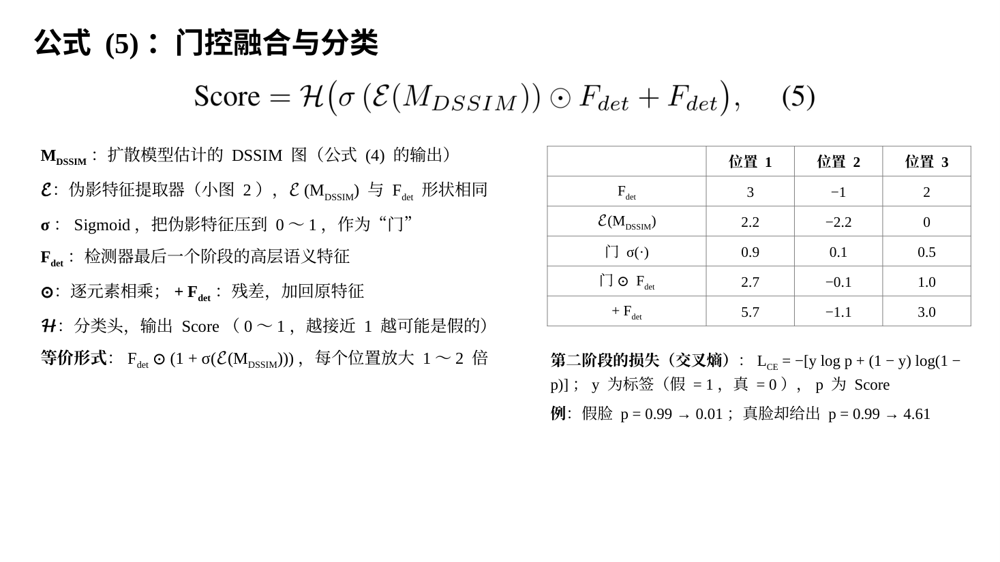

公式 (5) 对应模型图右下角的 Gating & Classifier，作用是把画好的 DSSIM 图和检测器的特征融合，输出伪造分数。

### 每个符号的含义（形状以 224×224 输入为例）

- Score：伪造分数，0 到 1 之间，越接近 1 越可能是假的。
- MDSSIM：扩散模型估计出来的 DSSIM 图，就是公式 (4) 最后得到的 x0，形状 1×224×224。M 是 Map 的意思。
- ℰ（花体 E）：伪影特征提取器，也就是小图 2。ℰ(MDSSIM) 是伪影特征，形状 1024×7×7。
- σ：Sigmoid 函数，把每个数压到 0 到 1 之间。σ(ℰ(MDSSIM)) 就是"门"，每个通道的每个位置各有一个门值。
- Fdet：检测器第 4 阶段的输出，即高层语义特征，形状 1024×7×7。det 是 detector 的缩写。
- ⊙：逐元素相乘。
- + Fdet：把原来的特征加回来，即残差连接。
- ℋ（花体 H）：分类头 Head，把 1024×7×7 的特征变成一个分数。

### 公式的意思

括号里的部分可以改写成 Fdet ⊙ (1 + σ(ℰ(MDSSIM)))。门值在 0 到 1 之间，所以 Fdet 的每个数被放大 1 到 2 倍：DSSIM 图认为痕迹明显的地方，门接近 1，放大到接近 2 倍；认为不明显的地方，门接近 0，基本保持原样。论文的说法是"有选择地强调与篡改相关的区域"。

接着小图 3 的例子：Fdet = [3, −1, 2]，伪影特征 = [2.2, −2.2, 0]，门 = [0.9, 0.1, 0.5]，融合结果 = [5.7, −1.1, 3.0]。再演示分类头：假设权重是 [0.5, 0.2, 0.6]，加权求和 5.7×0.5 + (−1.1)×0.2 + 3.0×0.6 ≈ 4.43，σ(4.43) ≈ 0.99，就是图里的 0.99。真实的分类头结构论文没写，这里只演示大意。

### 训练这部分用的损失

公式 (5) 这部分在第二阶段训练，用的是交叉熵损失（Cross-Entropy，CE）。论文只写了名字，二分类时的写法是：LCE = −[y · log p + (1 − y) · log(1 − p)]。y 是标签，假脸为 1，真脸为 0；p 是公式 (5) 输出的分数；log 是自然对数。举几个数：假脸、p = 0.99 时损失约 0.01，几乎没错；假脸、p = 0.1 时损失约 2.30；真脸却给出 p = 0.99 时损失约 4.61，越自信地判错，罚得越重。

---

## 第 15 页　训练策略：两阶段训练（约 4 分钟）

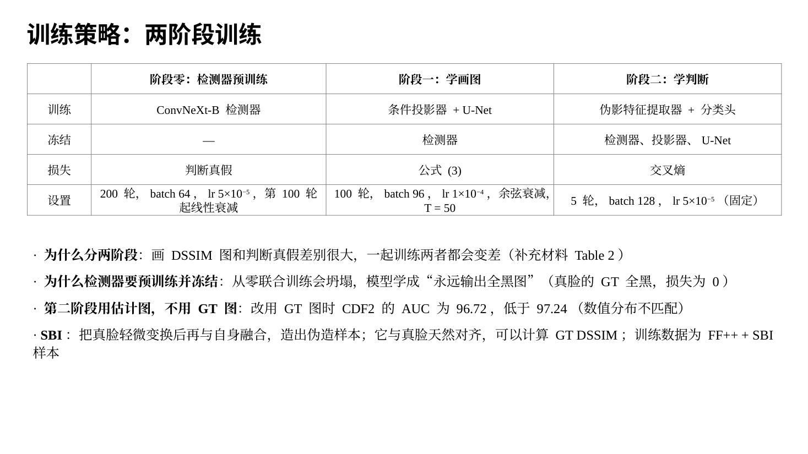

论文认为"画 DSSIM 图"和"判断真假"差别太大，放在一起同时训练，两件事都做不好，所以分两个阶段训练。另外，检测器本身在这之前就已经单独训练好了。

### 阶段零：先训练检测器

补充材料写明：ConvNeXt-B 检测器在 FF++ 上训练，并用 SBI 方法扩充训练数据；训练 200 轮，优化器 AdamW，批大小 64，初始学习率 5×10⁻⁵，从第 100 轮开始线性衰减。

SBI（Self-Blended Images，自融合图像）是一种造"假脸"的方法：把一张真脸做轻微的颜色、亮度、缩放、锐化等变换，再按人脸关键点生成的掩码和原图融合，得到一张"伪造"的脸。这张伪造脸和原来的真脸天然逐像素对齐，所以也能算出 GT DSSIM 图。

### 阶段一：学画图

- 训练：条件投影器和去噪扩散模型（U-Net）。
- 冻结：检测器。
- 损失：公式 (3)。
- 设置：100 轮，AdamW，批大小 96，初始学习率 1×10⁻⁴，按余弦曲线衰减；扩散步数 T = 50。

### 阶段二：学判断

- 训练：伪影特征提取器和分类头。
- 冻结：检测器、条件投影器、扩散模型。
- 损失：交叉熵。
- 设置：5 轮，AdamW，批大小 128，固定学习率 5×10⁻⁵。

所有实验在 8 张 NVIDIA RTX 3090 显卡上用 PyTorch 完成。

几个术语：轮（epoch）是把整个训练集完整过一遍；批大小（batch size）是每次更新参数时同时用多少张图；学习率是每次调整参数的步子大小；AdamW 是目前最常用的一种参数更新方法；余弦衰减是让学习率按余弦曲线从初始值慢慢降到接近 0，前期大步走、后期小步精调。

### 为什么检测器必须先训练好、再冻结

论文正文说，检测器和扩散模型一起从零开始训练会"训练坍塌"。补充材料解释了原因：真脸的 GT 图全是黑的，模型发现"不管输入什么，都输出全黑图"，在真脸上的损失就是 0，于是偷懒学成了这个最简单的解，再也学不会画假脸上的痕迹。先用一个训练好的检测器提供可靠的伪造线索，扩散模型才知道该在哪里画。

补充材料还提到，作者试过直接用 ControlNet（一种在冻结的 Stable Diffusion 上加条件网络的常用方法）来画 DSSIM 图，同样坍塌了，输出和输入无关。他们认为原因是 Stable Diffusion 是为彩色自然图像训练的，很难适应单通道的灰度 DSSIM 图。所以本文反过来：冻结提供条件的检测器，训练扩散模型本身。

### 第二阶段为什么不用 GT 图训练

补充材料做了一个实验：第二阶段改用 GT DSSIM 图当伪影特征提取器的输入，CDF2 上的 AUC 是 96.72，低于用扩散模型估计图时的 97.24。原因是 GT 图和估计图的数值分布不一样，比如真脸的 GT 图是精确的全 0。用 GT 图训练的分类器，到使用时面对估计图就不适应了。

---

## 第 16 页　实验设置（约 4 分钟）

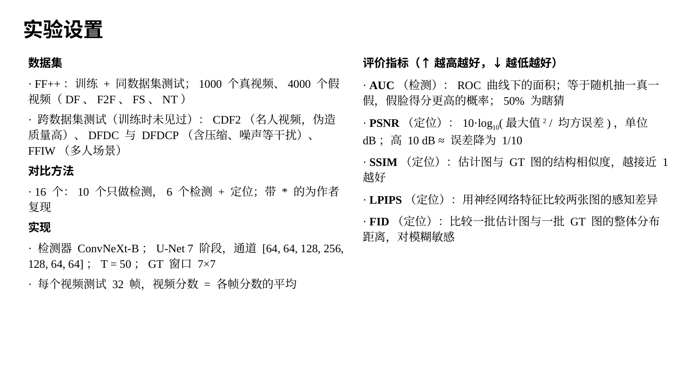

讲结果之前，先说明用了哪些数据、怎么评价。

### 数据集

- FF++（FaceForensics++）：用来训练，也用来做"同数据集测试"。它有 1000 个真实人脸视频，以及用 DF、F2F、FS、NT 四种方法生成的 4000 个假视频。
- 跨数据集测试用的四个数据集，训练时一张都没见过：CDF2（Celeb-DF v2），用更先进的换脸方法处理 YouTube 名人视频，伪造质量更高；DFDC（DeepFake Detection Challenge，深度伪造检测挑战赛数据集）和它的预览版 DFDCP，视频里带有压缩、降采样、噪声等各种干扰；FFIW（FFIW-10K），包含多人同时出现的场景。

同数据集测试是"在 FF++ 上训练，在 FF++ 的测试部分上测"。跨数据集测试是"在 FF++ 上训练，直接拿到没见过的数据集上测"，考的是泛化能力，也就是碰到没见过的伪造方法和拍摄条件时还能不能认出来。实际应用最看重这一项。

### 评价指标

表格里 ↑ 表示越高越好，↓ 表示越低越好；粗体是第一名，下划线是第二名。

- AUC：评价检测。模型输出的是分数，要判真假还得选一个阈值，比如大于 0.5 判为假。阈值不同，"假脸被抓到的比例"和"真脸被误判的比例"也不同。把所有阈值下这两个比例画成一条曲线叫 ROC 曲线，曲线下面的面积就是 AUC（Area Under the Curve）。它还有一个直观的含义：随机抽一张假脸和一张真脸，模型给假脸打的分更高的概率。50% 等于瞎猜，100% 是完美。视频级的结果是把每个视频里各帧的分数取平均。
- PSNR（峰值信噪比）：评价定位图，衡量估计图和 GT 图逐像素的误差。PSNR = 10 × log₁₀(最大值² / 均方误差)，单位是 dB。PSNR 高 10 dB，相当于均方误差降到原来的 1/10。
- SSIM：还是公式 (1) 里那个结构相似度。注意它在本文里有两种用法：做标准答案时，用 DSSIM = 1 − SSIM 比较真脸和假脸；评价结果时，用 SSIM 比较估计的 DSSIM 图和 GT DSSIM 图，越接近 1 越好。
- LPIPS：用一个训练好的神经网络分别提取两张图的特征，再比较特征的差距，更接近人眼"看起来像不像"的感觉，越低越好。
- FID：比较一批估计图和一批 GT 图在整体分布上的差距。做法是用 Inception 网络把每张图变成一组特征，分别统计两批特征的平均值和协方差，再算两个分布之间的距离。它对模糊特别敏感，越低越好。

### 对比方法和实现细节

论文和 16 个最新方法比较：10 个只做检测，6 个同时做检测和定位。表里带 * 号的结果是作者自己复现的，其余引自原论文。

实现细节：检测部分沿用 SBI 的预处理、数据增强和测试流程。人脸框用 RetinaFace 检测；训练时裁剪人脸的边距在 4% 到 20% 之间随机，测试时固定为 12.5%。训练时每个真视频抽 32 帧、每个假视频抽 8 帧，测试时每个视频均匀抽 32 帧。GT DSSIM 图在 FF++、CDF2、FFIW 上按公式 (1) 生成。

---

## 第 17 页　性能对比：跨数据集检测（表 1）（约 2 分钟）

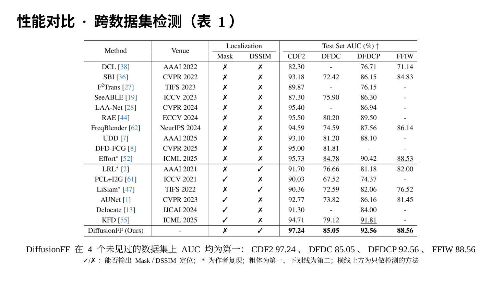

这是论文的表 1，跨数据集检测结果。先说怎么读：

- Method：方法名，方括号里是参考文献编号。
- Venue：发表的会议或期刊和年份，比如 CVPR 2022。
- Localization：这个方法能不能做定位。Mask 一列打 ✓ 表示能输出掩码，DSSIM 一列打 ✓ 表示能输出 DSSIM 图，两个都是 ✗ 表示只做检测。
- Test Set AUC (%)：在 CDF2、DFDC、DFDCP、FFIW 四个没见过的数据集上的 AUC。"-" 表示原论文没有报告这一项。
- 横线上面 10 个是只做检测的方法，下面 6 个是检测加定位的方法，最后一行是本文。

结果：DiffusionFF 在四个数据集上都是第一，分别是 CDF2 97.24、DFDC 85.05、DFDCP 92.56、FFIW 88.56。

和第二名相比：CDF2 比 Effort 的 95.73 高 1.51；DFDC 比 Effort 的 84.78 高 0.27；DFDCP 比 KFD 的 91.81 高 0.75；FFIW 比 Effort 的 88.53 高 0.03。Effort 和 KFD 都是 ICML 2025 的方法，KFD 还用到了大型视觉-语言模型。

和同样基于 DSSIM 图的 LRL 相比，四个数据集分别高 5.54、8.39、11.38、6.56；和 LiSiam 相比，分别高 6.88、12.46、10.50、12.04。

---

## 第 18 页　性能对比：跨数据集定位（表 2、图 4）（约 2 分钟）

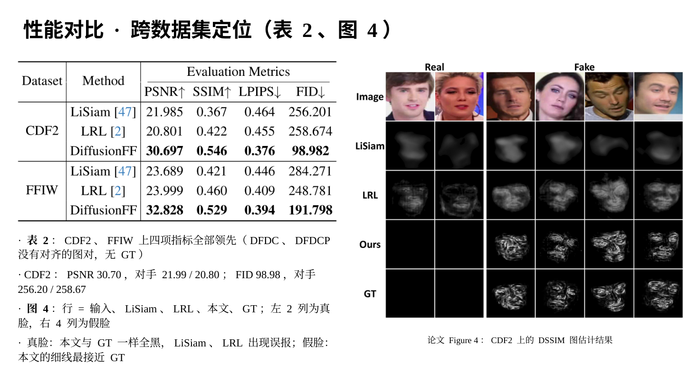

### 表 2：DSSIM 图估计得准不准

左边是表 2，比较在 CDF2 和 FFIW 上估计的 DSSIM 图和 GT 有多接近，对手是另外两个 DSSIM 方法 LiSiam 和 LRL。DFDC 和 DFDCP 的真假视频没有对齐，算不出 GT，所以这张表里没有它们。

四项指标 DiffusionFF 全部领先：

- CDF2 上，PSNR 30.697，LiSiam 21.985，LRL 20.801，高出约 9 到 10 dB，也就是均方误差只有对方的大约 1/7 到 1/10；SSIM 0.546，对方 0.367 和 0.422；LPIPS 0.376，对方 0.464 和 0.455；FID 98.982，对方 256 和 259，不到对方的一半。
- FFIW 上，PSNR 32.828，对方 23.689 和 23.999；SSIM 0.529，对方 0.421 和 0.460；LPIPS 0.394，对方 0.446 和 0.409；FID 191.798，对方 284 和 249。

### 图 4：在 CDF2 上画出来的样子

右边是图 4。先说怎么读：

- 五行从上到下：Image 是输入的人脸；LiSiam、LRL、Ours 是三种方法估计出的 DSSIM 图；GT 是标准答案。
- 六列：左边两列是真脸（Real），右边四列是假脸（Fake）。

能看出两点。第一，看真脸的两列：GT 是全黑的，本文的输出也是全黑的；LiSiam 和 LRL 却在真脸上也画出了灰色的块，等于"误报"。第二，看假脸的四列：LiSiam 是一团团模糊的灰影，LRL 有一些纹理但整体发灰，本文画出了细密的线条，和 GT 最接近。

这两张图表说明，即使在训练时没见过的数据集上，本文画的定位图也明显更准、更细。

---

## 第 19 页　性能对比：同数据集（表 3、表 4）（约 1 分钟）

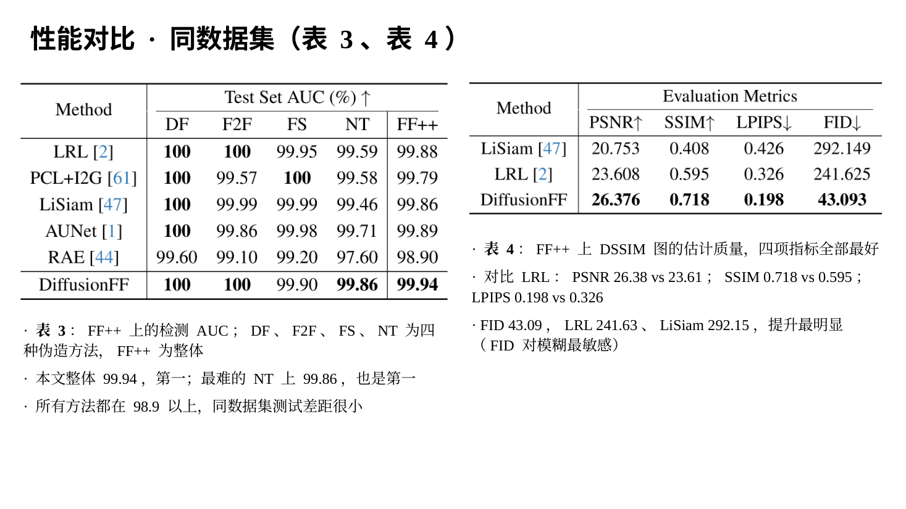

### 表 3：FF++ 上的检测

左边是表 3，在 FF++ 上训练、在 FF++ 上测的检测 AUC。DF、F2F、FS、NT 四列是分别在四种造假方法上的结果，最后一列 FF++ 是整体结果。

DiffusionFF 整体 99.94，排第一，在 DF 和 F2F 上都是 100，在最难的 NT 上是 99.86，也是第一。不过要说明一下：在同数据集上，所有方法都已经在 98.9 以上，差距很小，更能拉开差距的是前面的跨数据集测试。

### 表 4：FF++ 上的定位

右边是表 4，FF++ 上 DSSIM 图的估计质量。DiffusionFF 的 PSNR 26.376、SSIM 0.718、LPIPS 0.198、FID 43.093，四项全部最好。最明显的是 FID：LiSiam 292.149，LRL 241.625，本文只有 43.093，降到了 LRL 的不到五分之一。论文也特别强调了 FID 上的提升，因为 FID 对"糊不糊"最敏感。

---

## 第 20 页　DiffusionFF 学到了什么（图 5、图 6）（约 2 分钟）

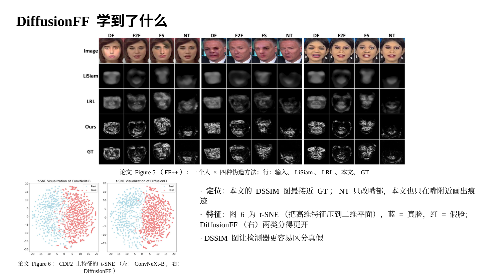

这一页用两张图直观看模型学到了什么。

### 图 5：FF++ 上的定位结果

上面是图 5，FF++ 上的定位结果。

怎么读：图里有三个人，每个人一组四列，分别是 DF、F2F、FS、NT 四种造假方法对同一个人做出的假脸。五行从上到下是输入图像、LiSiam、LRL、本文、GT。

可以看到：

- LiSiam 只能画出一团模糊的形状，不同造假方法画出来差不多。
- LRL 有一些脸部纹理，但整体发灰，细节不清楚。
- 本文画出的细线和 GT 很接近。而且不同造假方法下的差别也画出来了：NT 只改嘴部，本文在 NT 列上也只在嘴附近画了痕迹；DF 和 FS 是换脸，本文就画满了整张脸，和 GT 一致。

所以模型学到的不只是"这张脸有问题"，还学到了"不同造假方法会在哪些位置留下痕迹"。

### 图 6：特征的 t-SNE 可视化

下面是图 6，t-SNE 可视化。t-SNE 是一种把高维特征压到二维平面上画成散点图的方法，原本相似的点在图上会挨在一起。每个点代表 CDF2 里的一个样本，蓝色是真脸（Real），红色是假脸（Fake）。

左图是只用 ConvNeXt-B 检测器的特征，右图是 DiffusionFF 融合后的特征。左图里蓝点和红点大致分成两团，但交界处混在一起；右图两团分得更开，交界更清楚。这说明加上 DSSIM 图之后，真脸和假脸在特征上更容易区分，也就是检测器"更会分"了。补充材料在 DFDCP 和 FFIW 上也画了同样的图，结论一致。

---

## 第 21 页　消融实验：扩散模型的设计（表 5）（约 3 分钟）

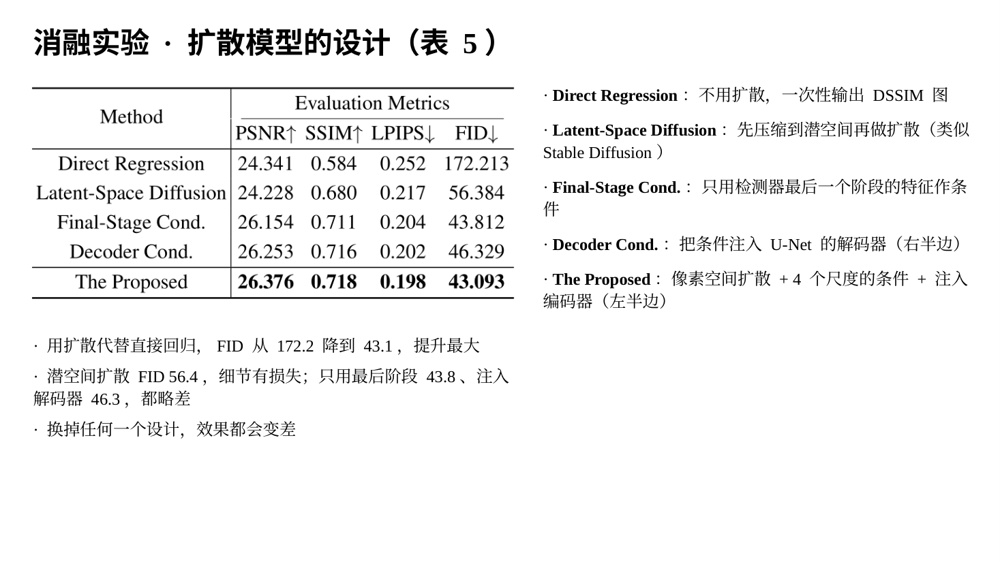

消融实验的意思是：把方法里的某个设计拿掉或者换掉，看效果变差多少，以此证明这个设计有用。表 5 测的是扩散模型部分的四个设计选择，在 FF++ 上评价 DSSIM 图的质量。

五行分别是：

- Direct Regression（直接回归）：保留检测器和条件，但不用扩散模型逐步去噪，让网络一次性输出 DSSIM 图。它对应的问题是"一步步画到底有没有用"。
- Latent-Space Diffusion（潜空间扩散）：像 Stable Diffusion 那样，先把图压缩到一个更小的"潜空间"里，在那里做扩散，最后再解码回图像。它对应的问题是"在像素上直接做扩散好，还是在压缩后的空间里做好"。
- Final-Stage Cond.（只用最后阶段做条件）：Cond. 是 conditioning 的缩写。只用检测器最后一个阶段的特征当条件，不用前 3 个阶段。它对应的问题是"多尺度条件有没有用"。
- Decoder Cond.（注入解码器）：把检测器的特征注入 U-Net 的右半边（解码器），而不是左半边（编码器）。它对应的问题是"条件注入在哪里更好"。
- The Proposed：本文的完整做法，即像素空间扩散、4 个尺度的条件、注入 U-Net 编码器。

结果：

- 直接回归最差，FID 172.213，本文是 43.093。用扩散模型代替直接回归带来的提升最大，这正是论文的核心论点。
- 潜空间扩散的 FID 56.384，比直接回归好很多，但比本文差，PSNR 24.228 甚至比直接回归还低一点。论文没解释原因，我的理解是压缩到潜空间会丢掉一两个像素宽的细线。
- 只用最后阶段做条件，FID 43.812；注入解码器，FID 46.329。都比本文略差，说明多尺度条件和注入编码器有用，但差距不大。

---

## 第 22 页　消融实验：融合方式与两阶段训练（表 6、补充材料表 2）（约 2 分钟）

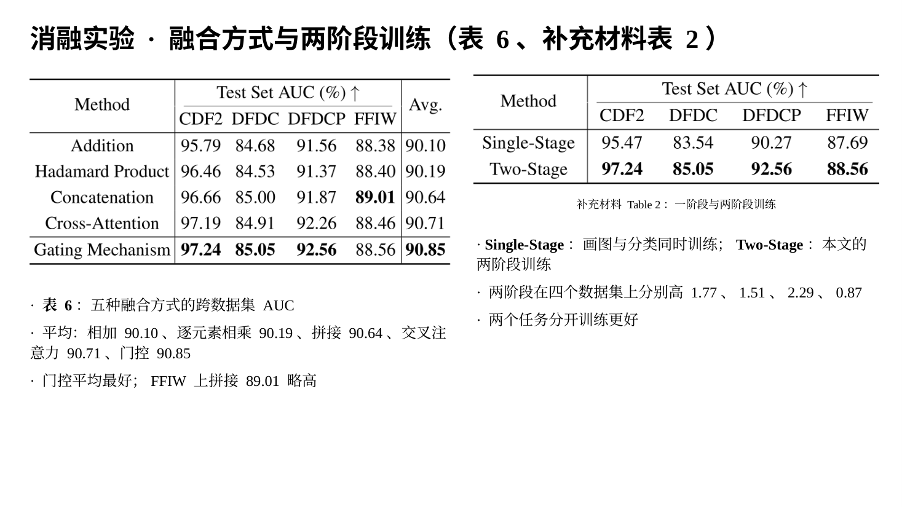

### 表 6：DSSIM 图和检测器特征怎么融合

表 6 比较五种融合方式，看的是四个跨数据集测试的 AUC 和平均值（Avg.）：

- Addition（相加）：伪影特征直接和 Fdet 相加，平均 90.10。
- Hadamard Product（逐元素相乘）：两者直接逐元素相乘，平均 90.19。
- Concatenation（拼接）：两组特征沿通道方向拼在一起，平均 90.64。
- Cross-Attention（交叉注意力）：让一组特征到另一组特征里"查找"相关信息，平均 90.71。
- Gating Mechanism（门控）：公式 (5) 的做法，平均 90.85，最高。

门控在 CDF2、DFDC、DFDCP 上都是第一，只有 FFIW 上拼接的 89.01 更高。整体来看门控最好，但几种方式之间的差距不到 1 个点。

### 补充材料表 2：一阶段训练和两阶段训练

右边是补充材料的表 2。Single-Stage 是把画图和分类放在一起同时训练，Two-Stage 是本文的两阶段训练。两阶段在四个数据集上分别高 1.77、1.51、2.29、0.87，说明把两个任务分开训练确实更好。

---

## 第 23 页　泛化能力：换成别的检测器（表 7）（约 2 分钟）

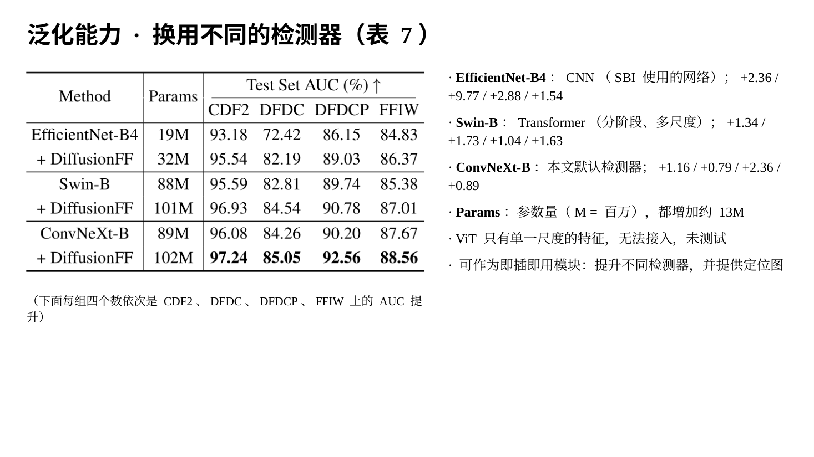

表 7 回答一个问题：DiffusionFF 是不是只对 ConvNeXt-B 有用？作者把检测器换成另外两种，看加上 DiffusionFF 以后是否都能涨分。

- EfficientNet-B4：2019 年提出的卷积神经网络。SBI 用的就是它，所以它这一行的成绩和表 1 里 SBI 的成绩完全一样。
- Swin-B：一种 Transformer 网络，但像卷积网络一样分阶段、有多个尺度的特征，所以能接上 DiffusionFF。
- ConvNeXt-B：本文默认用的检测器。
- Params：参数量，M 表示百万。三种检测器加上 DiffusionFF 以后都多了大约 1300 万个参数。

结果是三种检测器在四个数据集上全部涨分：

- EfficientNet-B4：分别涨 2.36、9.77、2.88、1.54，DFDC 上从 72.42 涨到 82.19，涨得最多。
- Swin-B：分别涨 1.34、1.73、1.04、1.63。
- ConvNeXt-B：分别涨 1.16、0.79、2.36、0.89。

另外，论文没有测 ViT（Vision Transformer），因为 ViT 每一层的特征尺寸都一样，没有多个尺度，没法给 U-Net 不同大小的层提供条件。论文据此称 DiffusionFF 是一个"即插即用"的模块：接到现有检测器上，既能涨分，又能多给一张可解释的定位图。

---

## 第 24 页　泛化能力：鲁棒性（图 7）（约 2 分钟）

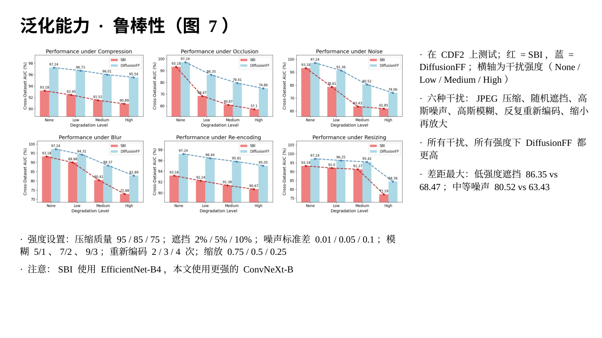

图 7 测鲁棒性，也就是图片质量变差时，模型的性能会掉多少。这模拟的是视频在网上传播时被压缩、转发、损坏的情况。测试数据是 CDF2，对手是 SBI，红色柱子是 SBI，蓝色柱子是 DiffusionFF，柱子上的数字是 AUC。

六个小图是六种干扰，每种有低、中、高三个强度，横轴的 None 表示不加干扰：

- Compression（JPEG 压缩）：质量 95、85、75，数值越低压得越狠。
- Occlusion（随机遮挡）：遮住 2%、5%、10% 的像素。
- Noise（高斯噪声）：标准差 0.01、0.05、0.1。
- Blur（高斯模糊）：模糊核大小和强度分别为 5/1、7/2、9/3。
- Re-encoding（反复重新编码）：分别做 2、3、4 次 JPEG 压缩，质量 95、90、85。
- Resizing（缩小再放大）：缩到原来的 0.75、0.5、0.25 倍，同时用质量 95、90、85 压缩，再放大回原尺寸。

结果是所有干扰、所有强度下 DiffusionFF 都比 SBI 高。差距最大的是遮挡和噪声：低强度遮挡时 SBI 从 93.18 掉到 68.47，DiffusionFF 是 86.35；中等强度噪声时 SBI 是 63.43，DiffusionFF 是 80.52。高强度压缩下 DiffusionFF 还有 95.54，几乎没掉。

需要说明一点：这里的对手 SBI 用的是 EfficientNet-B4，而 DiffusionFF 用的是更强的 ConvNeXt-B，所以鲁棒性的提升里，有一部分可能来自更强的检测器本身。

---

## 第 25 页　超参数敏感性分析（补充材料图 2、图 3）（约 2 分钟）

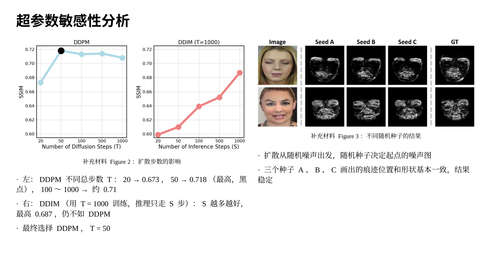

超参数是事先人为设定、不靠训练学出来的数，比如扩散的总步数 T。这一页看两个问题：T 取多少合适，以及随机种子会不会影响结果。

### 补充材料图 2：扩散步数

左图是 DDPM 在不同总步数 T 下画出的 DSSIM 图质量，纵轴是 SSIM。T = 20 时约 0.673；T = 50 时最高，约 0.718，就是那个黑点；T 再增大到 100、500、1000，反而略降，约 0.713、0.714、0.708。这和"步数越多生成质量越好"的一般印象不同。作者的解释是，本文的任务是有条件地估计灰度 DSSIM 图，和普通的彩色图像生成不一样，所以最优的步数也不一样。T = 50 时的 0.718 和表 4 中 FF++ 的 SSIM 一致，所以这组实验应该是在 FF++ 上做的。

右图是 DDIM。DDIM 是 DDPM 的一种加速采样方法，用 T = 1000 训练好的模型，推理时跳着走，只走 S 步。S 从 20 增加到 1000，SSIM 从约 0.599 升到约 0.687，但始终比不过 DDPM。所以作者选择了 DDPM 加 T = 50。

### 补充材料图 3：随机种子

扩散模型每次都从一张随机噪声图开始，随机种子决定抽到哪一张噪声图。图 3 对同一张输入人脸，用三个不同的种子 A、B、C 各画一次 DSSIM 图，最右边是 GT。可以看到三次画出来的图细节略有不同，但痕迹的位置和形状基本一致，说明结果是稳定的，不会因为换了一个随机种子就完全变样。

---

## 第 26 页　总结（约 2 分钟）

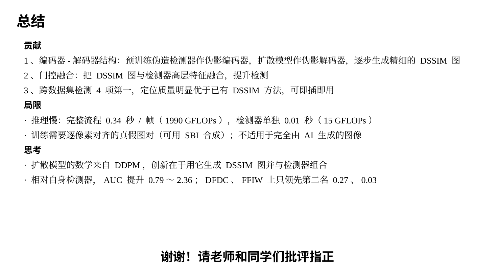

最后总结这篇论文。

### 论文的贡献

1. 提出一个新的编码器-解码器结构：预训练的伪造检测器当"伪影编码器"，去噪扩散模型当"伪影解码器"，以多尺度伪造特征为条件，逐步生成精细的伪影定位图。
2. 把生成的定位图通过门控机制和检测器的高层特征融合，提升了检测能力。
3. 检测性能在四个跨数据集测试上都达到最好，定位图的质量也明显超过已有的 DSSIM 方法；并且可以作为即插即用模块，提升不同的检测器。

### 局限

- 速度慢：每帧整个流程要 0.34 秒，计算量 1990 GFLOPs；单独跑检测器只要 0.01 秒、15 GFLOPs。时间主要花在扩散模型的 50 轮去噪上。作者的建议是：需要快速筛查时只用检测器，需要可解释的证据时再跑完整流程。
- 训练需要逐像素对齐的真假图对来计算 GT DSSIM 图。使用时只需要一张图；没有对齐图对的数据集可以用 SBI 这类方法自己造。
- 论文说明，这个方法不是为完全由 AI 生成的图像设计的，因为这类图像没有对应的真脸可比。

### 我的几点看法

- 扩散模型的数学部分（公式 2、3、4）来自 DDPM，本文没有修改。本文的创新在于把扩散模型用来画 DSSIM 图，并和检测器组合起来。
- 消融实验里，最大的提升来自"用扩散代替直接回归"；条件放在哪里、怎么融合，几种做法之间差距较小。
- 和自己的检测器 ConvNeXt-B 单独使用相比，四个数据集上 AUC 的提升是 0.79 到 2.36；在 DFDC 和 FFIW 上，比第二名只高 0.27 和 0.03。

我的汇报就到这里，谢谢大家，请老师和同学们批评指正。
