# DiffusionFF 汇报讲稿

论文：DiffusionFF: A Diffusion-based Framework for Joint Face Forgery Detection and Fine-Grained Artifact Localization（CVPR 2026）。

使用说明：讲稿与 PPT 逐页对应，每一节对应一页幻灯片，节标题里的页码就是幻灯片页码；每节开头附了该页幻灯片的缩略图。同样的文字也放进了 PPT 每页的“备注”里，放映时可以在演示者视图里看到。

篇幅：全文约 14,000 字，按每分钟 280 字计约 49 分钟。标有“时间紧可以略”的段落可以跳过。

## 目录

1. 标题页（约 1 分钟）
2. 背景（约 3 分钟）
3. 动机1 与创新点1（约 3 分钟）
4. 动机2 与创新点2（约 2 分钟）
5. 模型图（约 12 分钟）
6. 模型图：公式 (1)～(4)（约 10 分钟）
7. 模型图：公式 (5) 与两阶段训练（约 5 分钟）
8. 检测性能对比（约 2 分钟）
9. 定位性能对比（约 2 分钟）
10. DiffusionFF学到了什么（约 2 分钟）
11. 消融实验（约 2 分钟）
12. 泛化能力分析（约 2 分钟）
13. 超参数敏感性分析（约 2 分钟）

---

## 第 1 页　标题页（约 1 分钟）

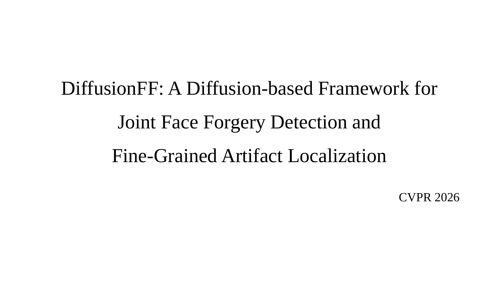

各位老师、同学好。我今天汇报的论文是《DiffusionFF: A Diffusion-based Framework for Joint Face Forgery Detection and Fine-Grained Artifact Localization》，发表在 CVPR 2026，作者来自中国科学院自动化研究所等单位。

题目可以分三部分理解。Diffusion 是扩散模型，它从一张纯噪声图开始，一步步去掉噪声，最后得到一张图。FF 是 Face Forgery，人脸伪造。后半句的意思是同时做"人脸伪造检测"和"细粒度伪影定位"：伪影（artifact）指造假留下的痕迹，细粒度指精细到像素。

一句话概括：输入一张人脸，模型同时输出一个伪造分数，回答"是不是假的"；再输出一张标出痕迹位置的灰度图，回答"假在哪里"。这张图由扩散模型一步步画出来，画完还会送回去帮助判断真假。

---

## 第 2 页　背景（约 3 分钟）

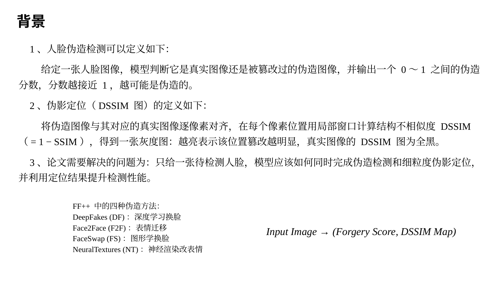

先介绍三个概念。

第一，人脸伪造检测。用 AI 换脸、改表情生成的假人脸统称 Deepfake，现在已经很难用肉眼分辨。人脸伪造检测就是给定一张人脸，判断它是真是假。这是一个二分类问题，模型输出 0 到 1 之间的伪造分数，越接近 1 越可能是假的。

第二，伪影定位和 DSSIM 图。只说"是假的"还不够，最好还能指出哪里是假的，这样人才看得懂模型的判断依据，论文称之为可解释性。本文用 DSSIM 图表示定位结果。DSSIM 是 Structural Dissimilarity（结构不相似度）的缩写，等于 1 减 SSIM；SSIM 是 Structural Similarity（结构相似度），衡量两张图在一个小区域里像不像，完全一样时等于 1。计算时，把一张假脸和它对应的原始真脸逐像素对齐，在每个像素位置比较周围一小块，得到一个 DSSIM 值；所有位置的值排在一起，就是一张灰度图，越亮表示这里改得越多。真脸和自己比处处相同，所以真脸的 DSSIM 图是全黑的。具体公式在模型部分的公式 (1) 讲。

要注意：算 DSSIM 图需要同时有假脸和对应的真脸。训练数据里有这样的图对，但实际使用时只有一张待检测的脸，所以 DSSIM 图只能由模型估计。

第三，论文要解决的问题：只给一张人脸，同时判断真假、精细地估计 DSSIM 图，并让估计的图帮助判断真假。

左下角是 FF++ 数据集里的四种伪造方法，后面的图里会反复出现它们的缩写：DF（DeepFakes）用深度学习换脸；F2F（Face2Face）把另一个人的表情迁移到这张脸上；FS（FaceSwap）用图形学方法换脸；NT（NeuralTextures）用神经渲染改表情，主要改嘴部。右下角是任务的输入和输出：输入一张人脸，输出伪造分数和 DSSIM 图。

---

## 第 3 页　动机1 与创新点1（约 3 分钟）

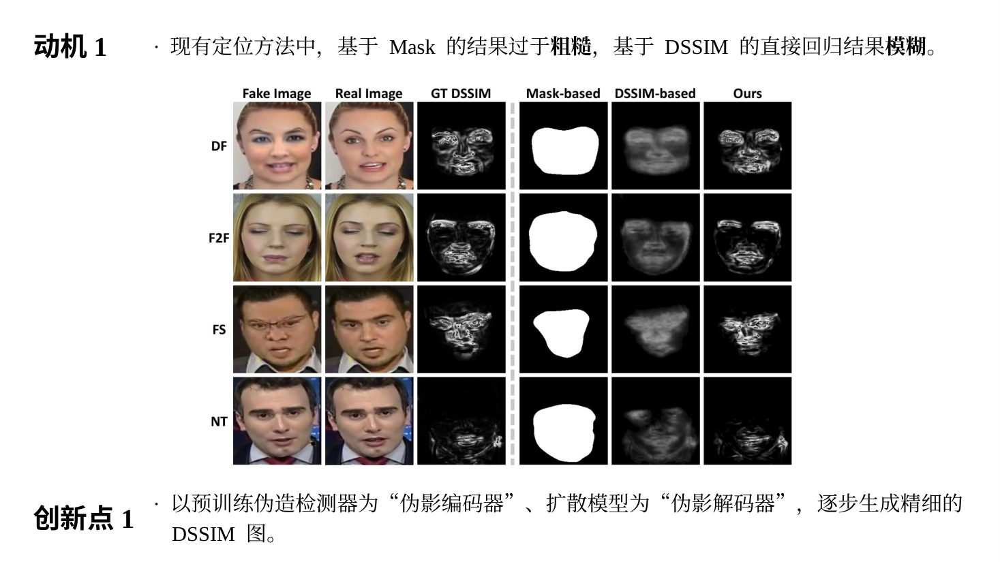

这是论文的 Figure 1，中间的虚线把它分成两部分。

左边三列是输入和标准答案。Fake Image 是假脸；Real Image 是这张假脸对应的原始真脸；GT DSSIM 是用这两张图按公式 (1) 算出的 DSSIM 图，GT 是 Ground Truth 的缩写，意思是标准答案。四行 DF、F2F、FS、NT 就是刚才说的四种伪造方法。可以看到，换脸的 DF 和 FS 整张脸都有亮纹，只改嘴部的 NT 只有嘴附近有亮点。

右边三列是三类方法估计出的定位图，越像第三列越好。Mask-based 是基于掩码的方法，它把定位当成分割，每个像素只判断"改了"或"没改"，所以输出一整块白色区域，看不出哪里改得多、哪里改得少。DSSIM-based 是已有的基于 DSSIM 的方法（如 LRL、LiSiam），目标同样是 DSSIM 图，但结果灰蒙蒙一片，细线都看不见。Ours 是本文方法，眉毛、眼睛、嘴周围的细线都和 GT 很接近。

这就是动机 1：Mask 方法太粗，已有的 DSSIM 方法太模糊。模糊的原因是它们用"直接回归"：网络看一眼人脸，一次性输出整张图，训练目标是让输出和 GT 的逐像素误差最小。举个例子，一条细痕迹可能在第 10 列，也可能在第 11 列，各占一半。如果网络只在第 10 列画亮线，有一半的概率完全画错；为了让平均误差最小，网络会把两列都画成半亮，清晰的细线就变成了模糊的宽线。用数学的话说，在均方误差下最好的输出是所有可能答案的平均，很多张清晰图平均下来就是一张糊图。

创新点 1：用编码器-解码器结构，让扩散模型一步步画出 DSSIM 图。编码器负责"看懂"输入，作者直接用一个已经训练好的伪造检测器，称为"伪影编码器"，它从人脸中提取多个尺度的伪造特征。解码器负责"画出"结果，作者把去噪扩散模型改造成"伪影解码器"，以这些特征为条件，从纯噪声开始逐步去噪，生成 DSSIM 图。扩散模型每一步只改一点：噪声大时先定下大致结构，噪声小时再补细节，所以能画出细线。论文指出，用扩散模型生成这种精细定位图的做法，此前基本没有人探索过。

---

## 第 4 页　动机2 与创新点2（约 2 分钟）

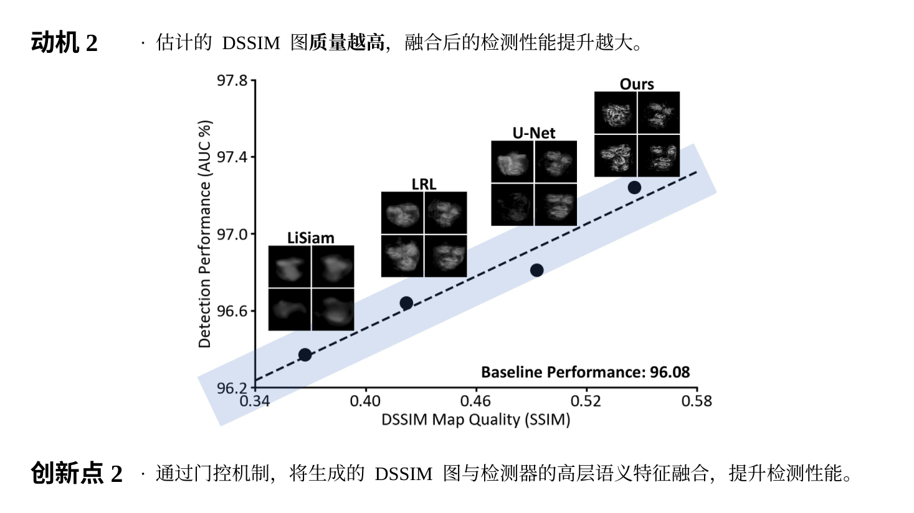

这是论文的 Figure 2，它说明 DSSIM 图的质量和检测性能之间的关系。

横轴是 DSSIM 图的质量，用估计图和 GT 图之间的 SSIM 衡量，越接近 1 越准。纵轴是检测性能 AUC，越高越好，具体含义在实验部分讲。右下角的 Baseline Performance: 96.08 是只用伪造检测器、不加 DSSIM 图时的 AUC。

四个黑点代表四种估计 DSSIM 图的方法：LiSiam、LRL、U-Net（用 U-Net 直接回归）和本文方法。每个点的做法相同：先用这种方法估计 DSSIM 图，再把图和同一个检测器的高层特征融合，然后测检测 AUC。黑点旁的小方块是这种方法估计的 DSSIM 图样例，虚线是趋势线。

可以读出两个结论。第一，四个点都高于基线 96.08，说明把估计的 DSSIM 图加进检测网络，检测都会变好。第二，图越准，提升越大：本文的图质量最高（约 0.546），AUC 也最高（97.24）。这两个数和后面表 2、表 1 中 CDF2 数据集的结果一致，所以这张图应该是在 CDF2 上做的，论文没有明说。把估计的 DSSIM 图送回网络帮助检测，这个思路来自已有方法 LiSiam，本文受此启发。这就是动机 2。

创新点 2：把画好的 DSSIM 图送回去帮助检测。先用"伪影特征提取器"把 DSSIM 图编码成特征，再用"门控机制"把它和检测器最后一层的高层语义特征融合，最后由分类头输出伪造分数。高层语义特征指网络最后几层算出的特征，概括的是整张脸的整体情况。门控的具体计算是公式 (5)。

两个创新点合起来就是：先把 DSSIM 图画准，再用画准的图提升检测。

---

## 第 5 页　模型图（约 12 分钟）

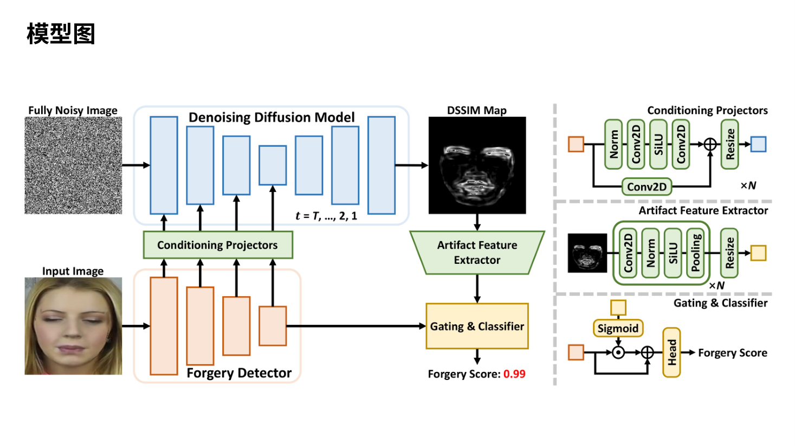

这是论文的 Figure 3，也就是模型图。我先说怎么看这张图，再顺着箭头走一遍主图，然后讲右边三个小图，最后讲小图里用到的基础组件。

### 怎么看这张图

灰色虚线把图分成左右两部分。左边是主图，画的是整体流程。右边上、中、下三个小图，分别放大了主图里的三个模块：条件投影器（Conditioning Projectors）、伪影特征提取器（Artifact Feature Extractor）、门控与分类器（Gating & Classifier）。

颜色有固定含义：橙色是伪造检测器和它算出的特征；蓝色是扩散模型和送进扩散模型的特征；绿色是本文新加的两个连接模块；黄色是门控与分类器，以及从 DSSIM 图提取出的特征。小方块表示一组特征，箭头表示数据流向。图注里的 N 是检测器的阶段数，本文 N = 4。

整个系统只有一个输入，就是左下角的人脸 Input Image。左上角的雪花图 Fully Noisy Image 不用我们提供，是程序随机生成的，它是扩散模型画图的起点。输出有两个：右上角的 DSSIM Map，回答"哪里是假的"；右下角的 Forgery Score，回答"是不是假的"，图中的 0.99 是一个示例，表示判为假脸。

### 主图流程

论文没写输入尺寸，下面以 224×224 为例说明数据的形状，写成"通道数 × 高 × 宽"。

第 1 步，人脸进入伪造检测器（Forgery Detector）。输入是 3×224×224 的数组，3 是红、绿、蓝三个颜色通道。检测器是 ConvNeXt-B，一种 2022 年提出的卷积神经网络，约 8900 万个参数。它已经在 FF++ 上训练好，在 DiffusionFF 里参数全程冻结，不再修改。它分 4 个阶段，对应图中 4 个越来越小的橙色方块：每过一个阶段，高和宽减半、通道数翻倍，输出依次是 128×56×56、256×28×28、512×14×14、1024×7×7。前面的阶段尺寸大，保留边缘、纹理等细节；后面的阶段尺寸小、通道多，概括整张脸的情况。这 4 组特征合称"多尺度特征"。第 4 阶段的输出记为 Fdet，它有两个去处：往上送进投影器，以及沿横向箭头直接送到门控与分类器。

第 2 步，条件投影器。检测器的特征和扩散模型需要的通道数、尺寸对不上，所以每组特征先经过一个投影器转换，再注入扩散模型。图中从投影器往上的 4 个箭头，分别进入扩散模型的前 4 个方块。

第 3 步，程序生成一张和 DSSIM 图一样大的纯噪声图，形状是 1×224×224，每个像素从标准正态分布中随机取值，大多落在 −2 到 2 之间。它在公式里记为 xT。

第 4 步，去噪扩散模型循环去噪。蓝色框里的网络是 U-Net，因为形状像字母 U 而得名：左边逐层缩小，叫编码器；右边逐层放大，叫解码器；左右同样大小的层之间有直接相连的"跳跃连接"，帮助恢复细节。补充材料写明它有 7 个阶段，通道数依次是 64、64、128、256、128、64、64，对应图中 7 个蓝色方块。框下面的 t = T, …, 2, 1 表示去噪步数从 T 倒着数到 1，本文 T = 50。每一步，U-Net 同时接收三样东西：当前带噪声的图、步数 t、检测器送来的特征。它预测出图中的噪声，再按公式 (4) 去掉一部分，得到干净一点的图。之所以倒着数，是因为 t 越大代表噪声越多：训练时第 0 步是干净图，第 50 步接近纯噪声；使用时从第 50 步倒着走回第 0 步。U-Net 还带一个时间步编码器（图上没画），把 t 转成一组数送进网络，让同一个网络知道当前噪声有多重。50 步共用同一份检测器特征，所以检测器和投影器只算 1 次，U-Net 要算 50 次。

第 5 步，50 步之后得到 DSSIM Map，形状 1×224×224，这是第一个输出。越亮表示篡改越明显；输入真脸时，输出应该接近全黑。

第 6 步，伪影特征提取器把 DSSIM 图加工成 1024×7×7 的伪影特征，形状和 Fdet 完全相同。图中绿色梯形上宽下窄，表示由大变小。

第 7 步，门控与分类器把伪影特征和 Fdet 融合，由分类头输出伪造分数，这是第二个输出。

补充材料给出了速度：每帧单独跑检测器约 0.01 秒，完整流程约 0.34 秒，时间主要花在 50 步去噪上。

### 右侧三个小图

小图 1，条件投影器。作用是当"转接头"：把检测器某一阶段的特征（左边橙色方块）转成扩散模型对应层能用的特征（右边蓝色方块）。流程是：输入分成两路，主路依次经过 Norm、Conv2D、SiLU、Conv2D，下面的捷径只经过一个 Conv2D；两路在 ⊕ 处相加，再经过 Resize 调整尺寸。×N 表示每个检测器阶段各配一个，共 4 个。捷径上也要有 Conv2D，因为主路改变了通道数，两路形状相同才能相加。

小图 2，伪影特征提取器。作用是把 DSSIM 图（1×224×224）变成和 Fdet 一样形状的特征（1024×7×7）。流程是：Conv2D、Norm、SiLU、Pooling 组成一轮，外框旁的 ×N 表示重复 4 轮，每一轮通道变多、尺寸变小，最后用 Resize 把尺寸调到正好和 Fdet 一致。每轮先卷积再池化，是为了先把一两个像素宽的细线记录进通道，再缩小尺寸，避免细线被直接平均掉。

小图 3，门控与分类器。上面的黄色方块是伪影特征，左边的橙色方块是 Fdet。黄色先经过 Sigmoid，变成 0 到 1 之间的"门"；橙色和门在 ⊙ 处逐元素相乘；下面绕过去的那条线，把原来的 Fdet 再加回来（⊕）；最后经过 Head（分类头）得到 Forgery Score。这就是公式 (5)，后面细讲。

### 小图中的基础组件

特征：网络中间算出来的一堆数，形状是"通道数 × 高 × 宽"。每个通道相当于一张响应图，某个位置的数越大，说明这个通道负责的图案在那里越明显。网络里能学习的数叫参数，训练就是用大量带答案的数据去调整参数。

Conv2D（二维卷积）：用一个小窗口在图上滑动，每到一个位置，把窗口下的数和窗口里的权重对应相乘再全部相加，得到一个输出数。比如权重第一行全是 −1、第二行全是 0、第三行全是 1，那么遇到"上暗下亮"的边缘时输出很大，遇到平坦区域时输出 0。权重是训练学出来的。一组权重只产生一个输出通道，想要 64 个输出通道就用 64 组权重，卷积就是这样改变通道数的。

Norm（归一化）：把一组数减去平均值、再除以标准差，变成平均值 0、标准差 1。比如 [2, 4, 6, 8] 会变成约 [−1.34, −0.45, 0.45, 1.34]。作用是让数值保持稳定，训练更容易。

激活函数：卷积只做乘法和加法，是线性运算，而两个线性运算连起来还是线性运算。比如第一层 y = 2x + 1，第二层 z = 3y − 2，合起来就是 z = 6x + 1，两层等于一层，叠多少层都一样。线性函数画出来是直线，不会拐弯，可很多规律需要拐弯。激活函数夹在层与层之间，引入非线性，网络才学得到复杂的规律。最简单的激活函数是 ReLU(x) = max(0, x)：负数变成 0，正数不变。两个 ReLU 就能拼出一个拐弯：|x| = ReLU(x) + ReLU(−x)。图中用的是 SiLU(x) = x · Sigmoid(x)，它和 ReLU 很像，正数基本保留，负数被压到接近 0，只是在 0 附近是平滑的弯，比如 SiLU(2) ≈ 1.76，SiLU(−2) ≈ −0.24。激活函数在 0 附近才起作用，所以小图里 Norm 总放在 SiLU 前面。

Sigmoid：σ(x) = 1 / (1 + e^(−x))，e 约等于 2.718。它把任何数压到 0 到 1 之间，例如 σ(−4) ≈ 0.02，σ(0) = 0.5，σ(4) ≈ 0.98。小图 3 用它当"门"：接近 0 表示关上，接近 1 表示全开。

Pooling（池化）：把相邻的 2×2 小块合成一个数（取最大值或平均值），高和宽各减半。

Resize：用插值把特征图缩放到指定尺寸。插值就是根据周围已有的数，估计新位置上的数。

⊕ 和 ⊙：⊕ 是逐元素相加，⊙ 是逐元素相乘（也叫 Hadamard 积），两边形状必须相同，例如 [1, 2, 3] ⊙ [0.5, 1, 0] = [0.5, 2, 0]。图中的 ⊕ 都是"残差连接"：输出 = 原输入 + 加工后的结果，这样既保住了原有信息，训练也更稳定。

Head 是分类头，把特征变成一个分数；×N 表示重复 N 次或一共 N 份，N = 4。

---

## 第 6 页　模型图：公式 (1)～(4)（约 10 分钟）

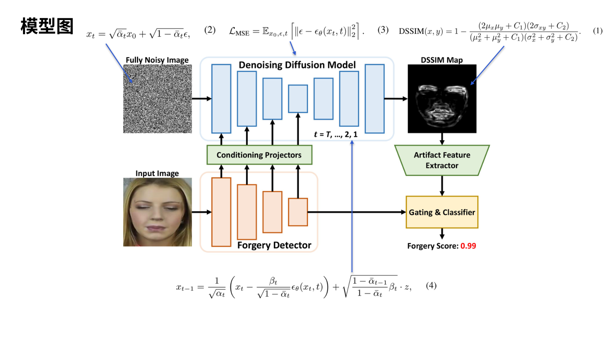

这一页把论文的公式放回模型图。右上角的公式 (1) 指向 DSSIM Map，它定义标准答案 GT DSSIM 怎么算；顶部的公式 (2)、(3) 指向噪声图和扩散模型，是训练扩散模型时用的；底部的公式 (4) 指向去噪循环，是真正使用时用的。先提醒一点：公式 (1) 里的 x、y 是真脸、假脸上的小窗口；公式 (2)～(4) 里的 x0、xt 是 DSSIM 图和它加了噪声的版本，都不是人脸。

### 公式 (1)：GT DSSIM 图怎么算

做法是把对齐的真脸和假脸叠在一起，用一个小方形窗口逐个像素滑动；窗口每停在一个位置，就用公式 (1) 算出一个数，作为 DSSIM 图在这个位置的值。

- (i, j)：像素位置，第 i 行、第 j 列。论文正文写的 DSSIM(i, j) 就是这个位置的值。
- x：真脸上以 (i, j) 为中心的窗口。补充材料写明窗口是 7×7，共 49 个像素。
- y：假脸上同一位置、同样大小的窗口。
- μx、μy（μ 读作"缪"）：窗口内 49 个像素的平均值，表示平均亮度。
- σx²、σy²（σ 读作"西格玛"）：窗口内像素的方差，表示明暗起伏有多大，也就是对比度；σx 是标准差。
- σxy：两个窗口的协方差，表示两块纹理是否同步变化：真脸这里亮、假脸这里也亮，它就是正的；两块纹理无关时接近 0。
- C1、C2：很小的常数，防止分母为 0，比如纯黑区域的平均值和方差都是 0。
- 减号后面的分式就是 SSIM。它由两个因子相乘：第一个因子比较平均亮度，第二个因子比较对比度和纹理。两个因子最大都是 1，因为分母减分子分别等于 (μx − μy)² 和"x 减 y"的方差，都不小于 0。

所以两个窗口完全一样时 SSIM = 1、DSSIM = 0，显示为黑色；差别越大，DSSIM 越大，显示越亮。举个例子，为了好算只用 4 个像素：真脸窗口是 [60, 150, 60, 150]。假脸如果只是整体亮了 30，变成 [90, 180, 90, 180]，DSSIM 约 0.03，几乎还是黑的；如果平均亮度不变，但纹理被抹平成 [105, 105, 105, 105]，DSSIM 约 0.97，非常亮。可见 DSSIM 对纹理结构的改变很敏感，而换脸留下的痕迹往往正是纹理被改了。真脸和自己比处处为 0，所以真脸的 GT 是一张全黑图。

### 公式 (2)：前向加噪

本文按照 DDPM（去噪扩散概率模型，2020 年提出）训练扩散模型。DDPM 有两个过程：前向过程加噪声，反向过程去噪声。公式 (2) 属于前向过程。

- x0：干净的图。在本文中，它就是上面算出的 GT DSSIM 图。
- t：第几步，从 1 到 T 的整数，T = 50。
- xt：加了 t 步噪声之后的图。
- ε（epsilon）：一张和 x0 一样大的噪声图。ε ∼ N(0, I) 表示它服从标准正态分布：平均值 0、方差 1，I 是单位矩阵，表示各个像素的噪声互相独立。
- βt（beta）：第 t 步加噪的强度，事先定好，不需要学习。补充材料写明它从 0.02 线性增加到 0.4。
- αt（alpha）= 1 − βt：第 t 步保留原信号的比例。
- ᾱt（alpha bar）= α1 × α2 × … × αt，即连乘，论文中写作 ∏。每个 α 都小于 1，所以 t 越大，ᾱt 越小。
- √ᾱt 是原图前面的系数，√(1 − ᾱt) 是噪声前面的系数，两者的平方和恒等于 1。

公式的意思是：第 t 步的图 = 一定比例的原图 + 一定比例的噪声。按本文的设置，t = 1 时原图系数约 0.99、噪声系数约 0.14，基本还是原图；t = 10 时分别约 0.75 和 0.66；t = 50 时原图系数只剩约 0.002，几乎是纯噪声。所以使用时可以直接从一张随机噪声图出发。这个公式的用处是：训练时想要第 t 步的噪声图，不用一步步加 t 次噪声，一次就能算出来。

（可选）它的来历：DDPM 原本定义每一步只加一点噪声，xt = √αt · xt−1 + √βt · ε。连写两步，会出现两份独立的高斯噪声；两个独立的高斯相加还是高斯，方差相加，α2 · β1 + β2 = 1 − α1α2 = 1 − ᾱ2。一直这样展开到第 t 步，就得到公式 (2)。

### 公式 (3)：训练损失

损失函数衡量网络"错得有多离谱"，训练就是不断调整参数，让它变小。

- LMSE：损失，MSE 是 Mean Squared Error，均方误差。
- εθ：去噪网络，也就是蓝色的 U-Net；θ（theta）代表它所有可学习的参数。
- εθ(xt, t)：把加噪图 xt 和步数 t 交给网络，网络输出它猜的噪声。
- ε：公式 (2) 中真正加进去的噪声。
- ‖ · ‖²₂：L2 范数的平方，就是逐像素求差、平方，再全部加起来。下标 2 表示 L2 范数，上标 2 表示平方。
- 𝔼（空心的 E）：期望，也就是求平均。下标 x0, ε, t 表示这三样都随机抽取：x0 从训练集里取，ε 从标准正态分布里抽，t 从 1 到 50 里随机选。

训练一步的过程是：取一张人脸和它的 GT DSSIM 图 x0（真脸配全黑图）；人脸送进冻结的检测器，经投影器得到条件特征；随机选 t、抽 ε，用公式 (2) 算出 xt；U-Net 根据 xt、t 和条件特征猜出噪声；最后用公式 (3) 计算损失，更新投影器和 U-Net 的参数。注意论文的公式 (3) 省略了条件，实际的网络是 εθ(xt, t, c)，c 就是投影器送来的检测器特征。

为什么猜噪声就够了？把公式 (2) 移项，得到 x0 = (xt − √(1 − ᾱt) · ε) / √ᾱt。只要知道噪声，就能反推出干净的图。

### 公式 (4)：反向去噪

这是训练好之后真正使用时的更新规则。从纯噪声 xT 出发，每用一次公式 (4)，图就干净一点；从 t = 50 用到 t = 1，最后得到的 x0 就是估计的 DSSIM 图。

- xt：当前的图，第一次是纯噪声 x50；xt−1：去掉一点噪声后的图，作为下一轮的输入。
- εθ(xt, t)：U-Net 猜出的噪声（同样省略了条件 c）。
- βt / √(1 − ᾱt)：减噪比例，决定这一步减掉多少猜出来的噪声。
- 1 / √αt：放大系数。前向过程每一步都乘了 √αt，这里除回去。
- √[(1 − ᾱt−1) / (1 − ᾱt) · βt] · z：新加的随机项，z ∼ N(0, I) 是这一轮新抽的随机噪声，只在 t > 1 时加。z 和 ε 不同：ε 是训练时加进去让网络猜的噪声，z 是使用时每一步新加的噪声。

公式分前后两半。前半是"把猜出来的噪声按比例减掉，再放大一点"，得到 xt−1 最可能的样子。后半是再加一点随机噪声，因为 xt−1 本来应该是从一个分布里抽出的样本，如果每步只取最可能的样子，最后得到的又会是平均出来的糊图。按本文的设置，t = 50 时减噪比例约 0.40、随机项系数约 0.63，一开始改得很猛；t = 1 时随机项系数正好是 0，最后一步本来就不加噪声，和论文"只在 t > 1 时加 z"一致。

（可选）它的来历：如果同时知道 xt 和 x0，用贝叶斯公式可以算出 xt−1 的分布，它是一个高斯分布，方差正好是随机项系数的平方。使用时不知道 x0，就把公式 (2) 移项得到的 x0 代进去，化简后均值正好是公式 (4) 的前半，最后把真噪声 ε 换成网络猜的 εθ。

对照模型图：x50 是左上角的 Fully Noisy Image，每轮的 xt 在蓝色框里循环，t 就是框下面的 t = T, …, 2, 1，εθ 是蓝色的 U-Net，最终的 x0 是右上角的 DSSIM Map。

---

## 第 7 页　模型图：公式 (5) 与两阶段训练（约 5 分钟）

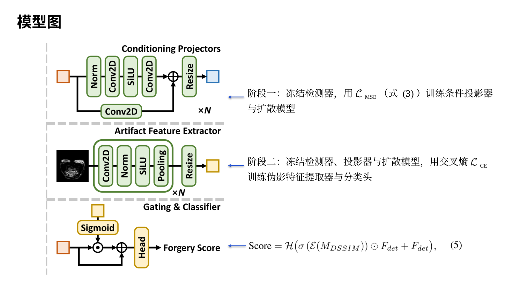

这一页把右边的三个小图放大，讲公式 (5) 和训练方法。

### 公式 (5)：门控融合与分类

公式 (5) 对应最下面的门控与分类器。形状仍以 224×224 的输入为例。

- Score：伪造分数，0 到 1 之间，越接近 1 越可能是假的。
- MDSSIM：扩散模型估计出的 DSSIM 图，也就是公式 (4) 最后得到的 x0，形状 1×224×224。M 是 Map 的意思。
- ℰ（花体 E）：伪影特征提取器，也就是中间的小图。ℰ(MDSSIM) 是伪影特征，形状 1024×7×7。
- σ：Sigmoid 函数，把每个数压到 0 到 1 之间。σ(ℰ(MDSSIM)) 就是"门"，每个通道的每个位置各有一个门值。注意这里的 σ 和公式 (1) 里表示方差的 σ 不是一回事。
- Fdet：检测器第 4 阶段的输出，即高层语义特征，形状 1024×7×7，det 是 detector 的缩写。
- ⊙：逐元素相乘；+ Fdet：把原来的特征加回来，即残差连接。
- ℋ（花体 H）：分类头，把 1024×7×7 的特征变成一个分数。

括号里的部分等于 Fdet ⊙ (1 + σ(ℰ(MDSSIM)))。门值在 0 到 1 之间，所以 Fdet 的每个数会被放大 1 到 2 倍：DSSIM 图认为痕迹明显的位置，门接近 1，被放大到接近 2 倍；认为不明显的位置，门接近 0，基本保持原样。论文的说法是"有选择地强调与篡改相关的区域"。举个只有 3 个位置的例子：Fdet = [3, −1, 2]，伪影特征 = [2.2, −2.2, 0]，门 = [0.9, 0.1, 0.5]，相乘得 [2.7, −0.1, 1.0]，再加回 Fdet 得 [5.7, −1.1, 3.0]。

为什么要加回 Fdet？如果只相乘，门值接近 0 的位置，检测器原来的特征会被抹掉；而 DSSIM 图是估计出来的，可能画错。加回去以后，每个位置只会被放大，不会被抹掉。

### 两阶段训练

论文认为画 DSSIM 图和判断真假差别很大，放在一起训练两边都做不好，所以分两个阶段，右边的两行文字分别指向对应的模块。

在此之前，检测器 ConvNeXt-B 已经单独训练好：用 FF++ 训练 200 轮，并用 SBI 方法扩充数据。SBI（Self-Blended Images）是把一张真脸做轻微的颜色、形状变换后再和它自己融合，造出一张伪造脸，这张伪造脸和原来的真脸天然对齐，所以也能算出 GT DSSIM 图。

阶段一，学画图：冻结检测器，用公式 (3) 训练条件投影器和扩散模型，训练 100 轮。

阶段二，学判断：冻结检测器、投影器和扩散模型，用交叉熵损失训练伪影特征提取器和分类头，训练 5 轮。交叉熵（论文只写了名字）是 LCE = −[y · log p + (1 − y) · log(1 − p)]，其中 y 是标签（假脸为 1，真脸为 0），p 是公式 (5) 输出的分数。例如假脸给出 p = 0.99，损失约 0.01；真脸却给出 p = 0.99，损失约 4.61，越自信地判错，罚得越重。

补充材料还说明了几个设计的原因：

- 检测器为什么要先训练好再冻结：如果和扩散模型一起从零训练，模型会偷懒，学成"不管输入什么都输出全黑图"，因为真脸的 GT 本来就是全黑的，这样在真脸上的损失为 0，再也学不会画假脸的痕迹。
- 为什么分两阶段：和一起训练相比，两阶段训练在四个跨数据集测试上的 AUC 都更高。
- 第二阶段为什么用估计图而不用 GT 图：改用 GT 图训练时，CDF2 上的 AUC 是 96.72，低于用估计图时的 97.24，因为 GT 图和估计图的数值分布不一样。

---

## 第 8 页　检测性能对比（约 2 分钟）

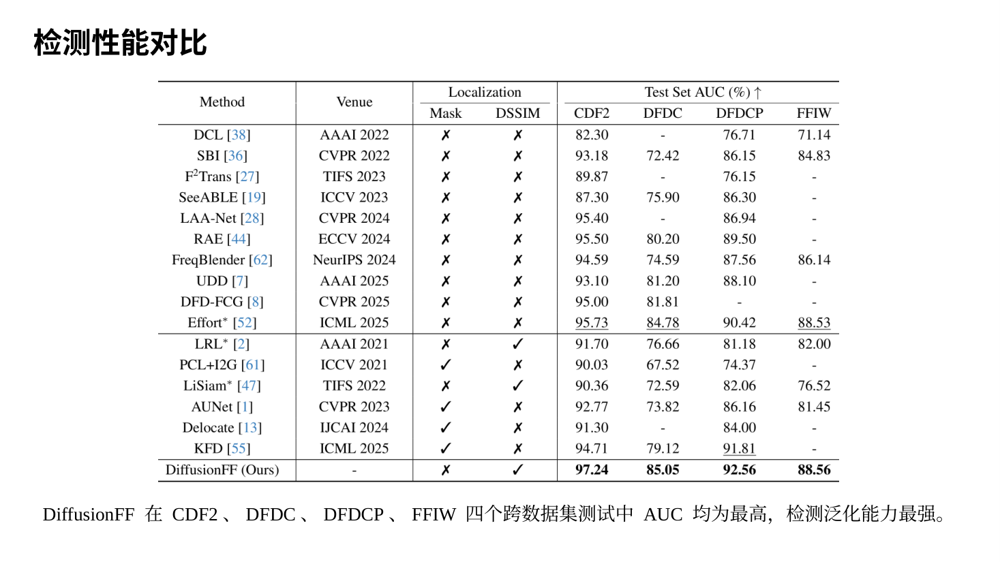

这是论文的表 1，比较跨数据集检测性能。

先说实验设置。所有方法都在 FF++ 上训练，FF++ 有 1000 个真实视频和用四种方法生成的 4000 个伪造视频。测试用四个训练时没见过的数据集：CDF2（Celeb-DF v2，名人视频，伪造质量更高）、DFDC 和它的预览版 DFDCP（深度伪造检测挑战赛数据，带有压缩、噪声等干扰）、FFIW（多人场景）。这叫跨数据集测试，考的是泛化能力，也就是遇到没见过的伪造方法和拍摄条件时还能不能认出来。

评价指标 AUC：模型输出的是分数，判断真假还要选一个阈值，阈值不同，"假脸被抓到的比例"和"真脸被误判的比例"也不同。把所有阈值下这两个比例画成 ROC 曲线，曲线下的面积就是 AUC。它也可以理解为：随机抽一张假脸和一张真脸，模型给假脸打分更高的概率。50% 等于瞎猜，100% 是完美。

怎么读这张表：Method 是方法名；Venue 是发表的会议或期刊；Localization 表示能否定位，Mask 列打勾表示能输出掩码，DSSIM 列打勾表示能输出 DSSIM 图；右边四列是四个测试集上的 AUC，"-" 表示原论文没报告。带 * 的结果是作者复现的，粗体是第一名，下划线是第二名。横线上方 10 个方法只做检测，下方 6 个同时做检测和定位。

结果：DiffusionFF 在四个数据集上都是第一，CDF2 97.24、DFDC 85.05、DFDCP 92.56、FFIW 88.56。和第二名相比，CDF2 高 1.51，DFDCP 高 0.75，DFDC 和 FFIW 分别只高 0.27 和 0.03。和同样基于 DSSIM 的 LRL、LiSiam 相比，提升在 5.5 到 12.5 个点之间。

---

## 第 9 页　定位性能对比（约 2 分钟）

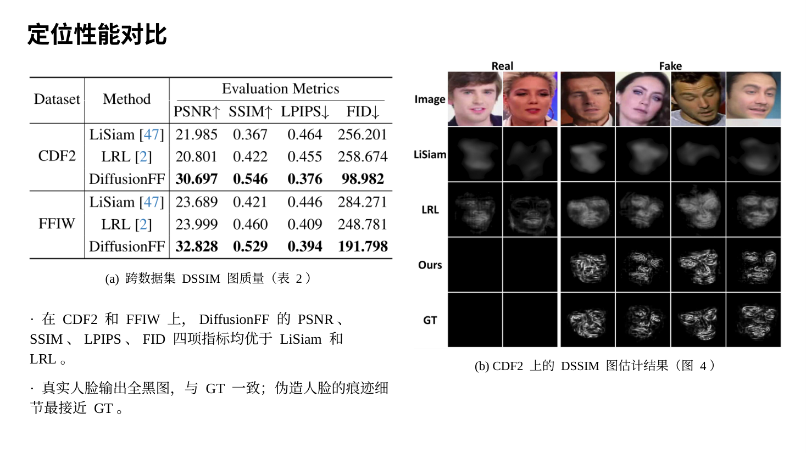

这一页比较定位效果，也就是估计的 DSSIM 图和 GT 有多接近，对手是另外两个 DSSIM 方法 LiSiam 和 LRL。DFDC 和 DFDCP 的真假视频没有对齐，算不出 GT，所以只在 CDF2 和 FFIW 上比较。

表里有四个评价指标，↑ 表示越高越好，↓ 表示越低越好：

- PSNR（峰值信噪比）：衡量逐像素的误差，单位 dB，高 10 dB 相当于均方误差降到原来的 1/10。
- SSIM：结构相似度，就是公式 (1) 里那个分式，这里用来比较估计图和 GT 图，越接近 1 越好。
- LPIPS：用一个训练好的神经网络提取两张图的特征再比较，更接近人眼"看起来像不像"的感觉。
- FID：比较一批估计图和一批 GT 图在整体分布上的距离，对模糊特别敏感。

左边表 2 中，DiffusionFF 四项指标全部最好。以 CDF2 为例，PSNR 是 30.70，LiSiam 和 LRL 分别是 21.99 和 20.80；FID 是 98.98，对手分别是 256.20 和 258.67，不到对手的一半。

右边图 4 是 CDF2 上的可视化结果。五行从上到下是输入人脸、LiSiam、LRL、本文、GT；左边两列是真脸，右边四列是假脸。看真脸：GT 是全黑的，本文输出也是全黑的，而 LiSiam 和 LRL 在真脸上也画出了灰色区域，等于误报。看假脸：LiSiam 是模糊的一团，LRL 有些纹理但整体发灰，本文画出的细线和 GT 最接近。论文在训练用的 FF++ 测试集上也做了同样的比较，结论一致，这里不展开。

---

## 第 10 页　DiffusionFF学到了什么（约 2 分钟）

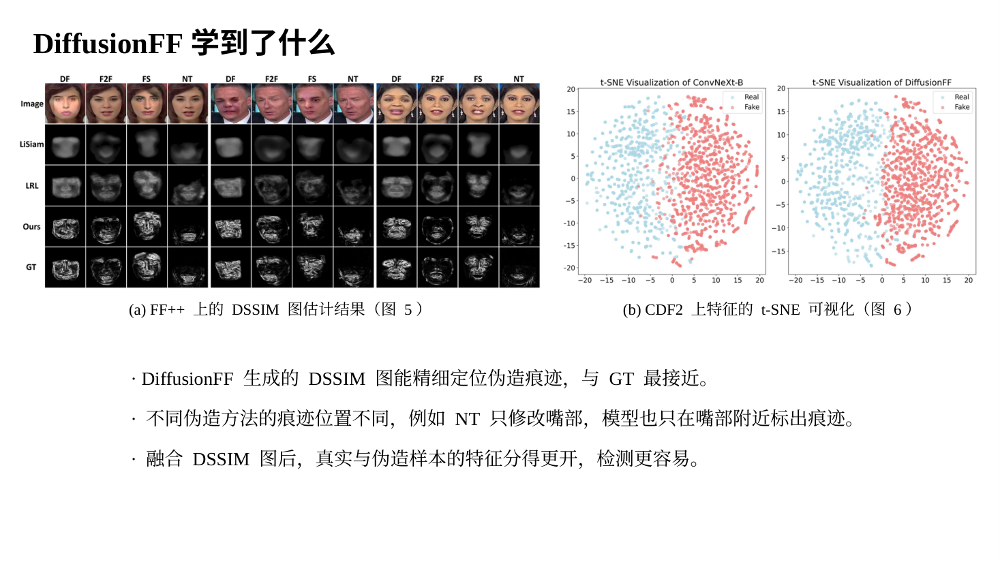

这一页用两张图看模型学到了什么。

图 (a) 是论文的 Figure 5，FF++ 上的定位结果。图中有三个人，每人一组四列，分别是 DF、F2F、FS、NT 四种方法对同一个人做的假脸；五行从上到下是输入、LiSiam、LRL、本文、GT。可以看到，本文画出的痕迹和 GT 最接近，而且能区分不同伪造方法：NT 只改嘴部，本文在 NT 列上也只在嘴附近标出痕迹；DF 和 FS 是换脸，本文就画满整张脸，和 GT 一致。

图 (b) 是论文的 Figure 6，t-SNE 可视化。t-SNE 是一种把高维特征压到二维平面画成散点图的方法，原本相似的点在图上会挨在一起。每个点是 CDF2 中的一个样本，蓝色是真脸，红色是假脸。左图只用 ConvNeXt-B 检测器的特征，右图是 DiffusionFF 融合后的特征。左图两类大致分开，但交界处混在一起；右图分得更开，说明加入 DSSIM 图之后，真脸和假脸更容易区分。

这就是下面三条结论：DSSIM 图能精细定位痕迹；不同伪造方法的痕迹位置不同，模型都能标出来；融合 DSSIM 图后检测更容易。

---

## 第 11 页　消融实验（约 2 分钟）

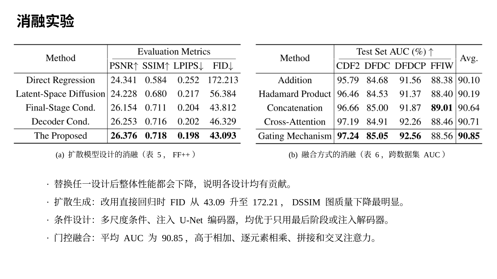

消融实验的意思是：把方法中的某个设计拿掉或换掉，看效果变差多少，以此证明这个设计有用。

表 (a) 是论文的表 5，在 FF++ 上比较扩散模型部分的设计，看的是 DSSIM 图的质量：

- Direct Regression：不用扩散模型逐步去噪，让网络一次性输出 DSSIM 图。FID 是 172.21，而本文是 43.09，差距最大。这说明"一步步画"是效果的主要来源。
- Latent-Space Diffusion：像 Stable Diffusion 那样，先把图压缩到更小的"潜空间"里做扩散，再解码回图像。FID 是 56.38，比本文差。论文没解释原因，我的理解是细线在压缩时会丢失一些。
- Final-Stage Cond.：只用检测器最后一个阶段的特征做条件，不用前 3 个阶段，FID 43.81。
- Decoder Cond.：把检测器特征注入 U-Net 的右半边（解码器），而不是左半边（编码器），FID 46.33。
- The Proposed 是本文的完整做法：在像素上直接做扩散，用 4 个尺度的条件，并注入 U-Net 编码器，四项指标都最好。

表 (b) 是论文的表 6，比较 DSSIM 特征和检测器特征的五种融合方式，看的是四个跨数据集测试的 AUC 和平均值：相加 90.10，逐元素相乘 90.19，拼接 90.64，交叉注意力 90.71，本文的门控 90.85，平均最高。只有 FFIW 一列拼接略高。

结论是：替换任何一个设计，整体效果都会下降，说明每个设计都有用；其中影响最大的是用扩散生成代替直接回归。

---

## 第 12 页　泛化能力分析（约 2 分钟）

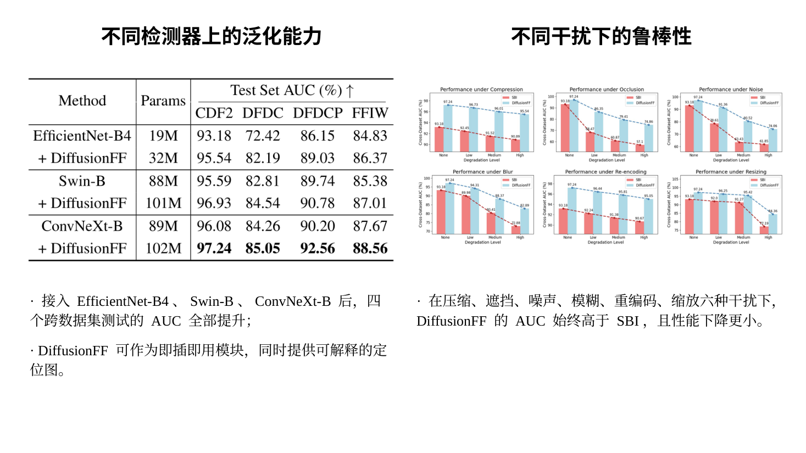

这一页分左右两部分，都在看方法的泛化能力。

左边看换一个检测器还有没有用，是论文的表 7。作者把 DiffusionFF 分别接到三种检测器上：EfficientNet-B4（2019 年的卷积网络，也是 SBI 用的网络）、Swin-B（一种分阶段、多尺度的 Transformer 网络）和本文默认的 ConvNeXt-B。Params 是参数量，M 表示百万，三种检测器接上后都多出约 1300 万参数。结果是三种检测器在四个数据集上的 AUC 全部提升，例如 EfficientNet-B4 在 DFDC 上从 72.42 提升到 82.19；ConvNeXt-B 提升 0.79 到 2.36 个点。所以 DiffusionFF 可以作为即插即用的模块，既能提升检测，又能多给出一张定位图。论文没有测 ViT，因为 ViT 只有单一尺度的特征，没法给 U-Net 的不同层提供条件。

右边看鲁棒性，是论文的图 7，也就是图片质量变差时性能掉多少，模拟视频在网上被压缩、转发、损坏的情况。测试数据是 CDF2，红色柱子是 SBI，蓝色柱子是 DiffusionFF。六个小图是六种干扰：JPEG 压缩、随机遮挡、高斯噪声、高斯模糊、反复重新编码、缩小再放大；横轴是干扰强度，None 表示不加干扰，Low、Medium、High 依次加重。结果是所有干扰、所有强度下 DiffusionFF 都更高，而且下降得更少。差距最大的是遮挡和噪声，例如低强度遮挡时 SBI 从 93.18 掉到 68.47，DiffusionFF 是 86.35。要说明的是，SBI 用的检测器是 EfficientNet-B4，本文用的是更强的 ConvNeXt-B。

---

## 第 13 页　超参数敏感性分析（约 2 分钟）

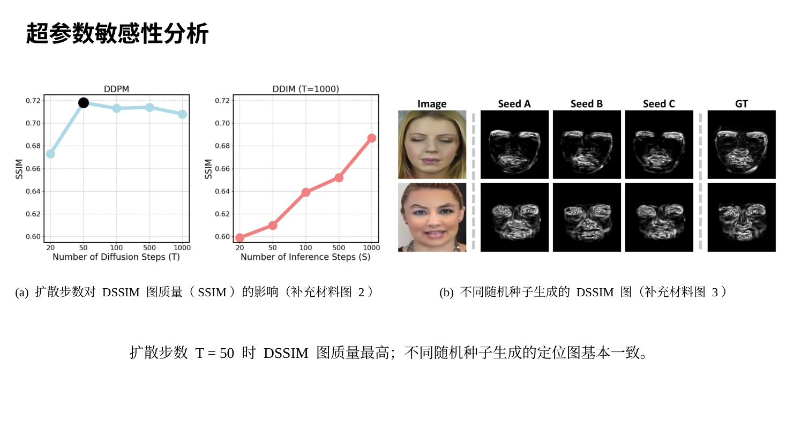

最后看超参数。超参数是事先人为设定、不靠训练学出来的数，比如扩散的总步数 T。这两张图来自补充材料。

图 (a) 左边是 DDPM 在不同总步数 T 下生成的 DSSIM 图质量，纵轴是 SSIM。T = 20 时约 0.673；T = 50 时最高，约 0.718，就是那个黑点；T 再增大到 100、500、1000，反而略有下降。作者的解释是，本文的任务是在条件下估计灰度 DSSIM 图，和普通的彩色图像生成不同，所以最合适的步数也不同。右边的 DDIM 是一种加速采样方法，用 T = 1000 训练，推理时只走 S 步；S 越大越好，但始终不如 DDPM。所以本文选择 DDPM、T = 50。

图 (b) 看随机种子的影响。扩散模型每次都从一张随机噪声图开始，随机种子决定抽到哪张噪声图。对同一张人脸用 A、B、C 三个种子各生成一次，最右边是 GT。三次结果的细节略有不同，但痕迹的位置和形状基本一致，说明结果稳定。

最后简单总结：这篇论文用预训练的伪造检测器作编码器、扩散模型作解码器，逐步生成精细的 DSSIM 定位图，再通过门控把定位图送回检测器，在跨数据集检测和定位上都取得了最好的结果。它的主要局限是速度：完整流程每帧约 0.34 秒，而单独跑检测器只要 0.01 秒，时间主要花在 50 步去噪上。

我的汇报就到这里，谢谢大家，请老师和同学们批评指正。
