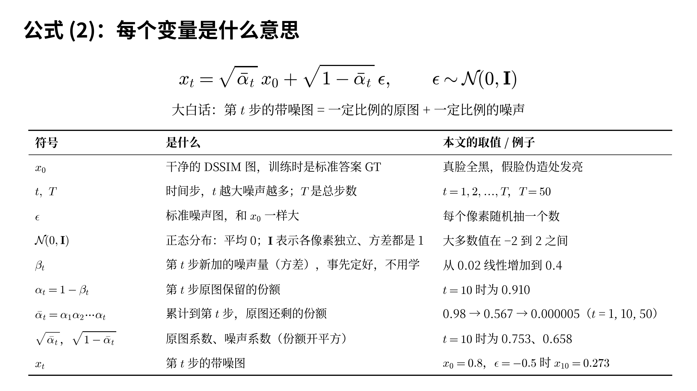
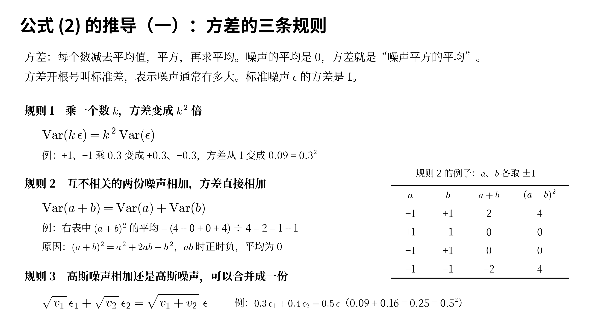
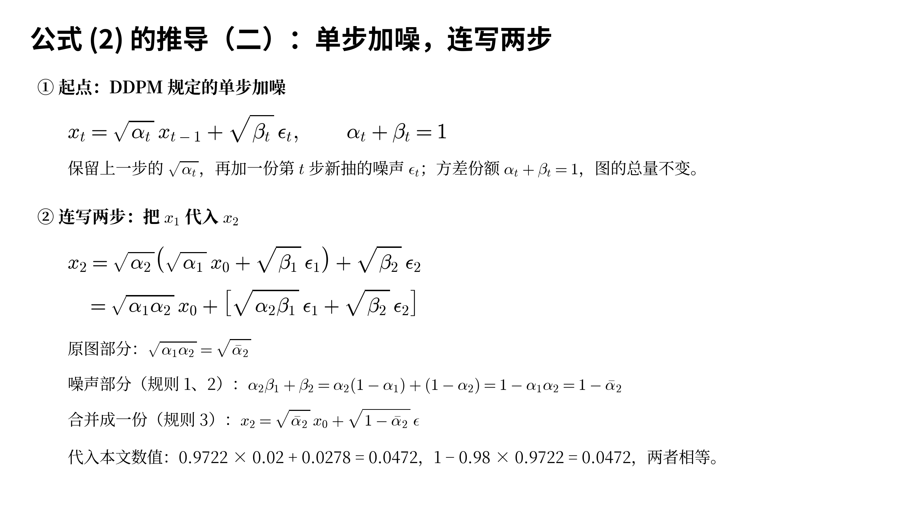
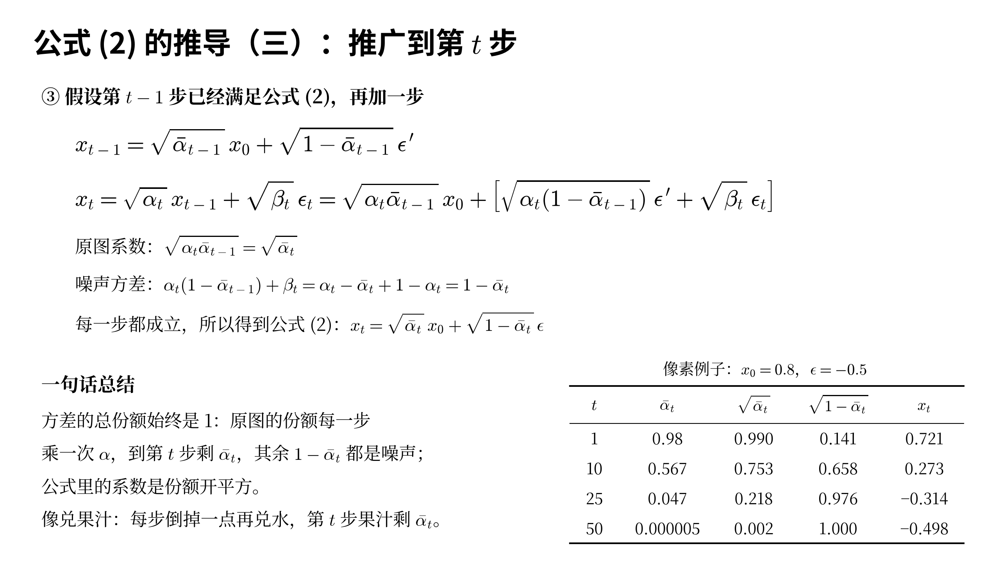
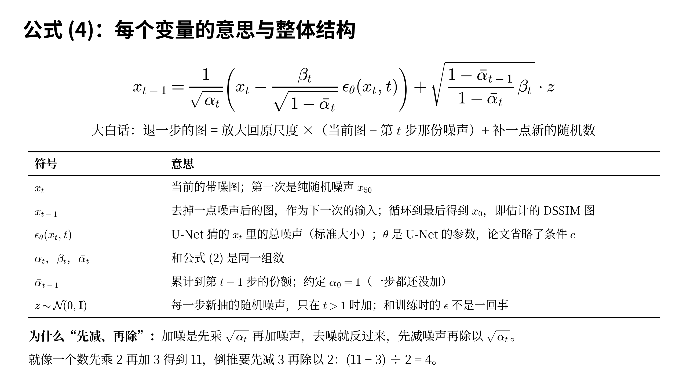
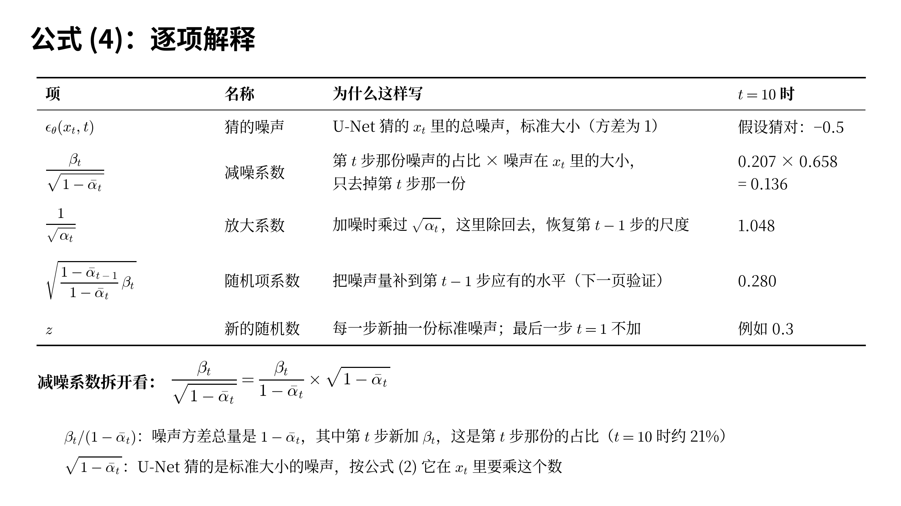
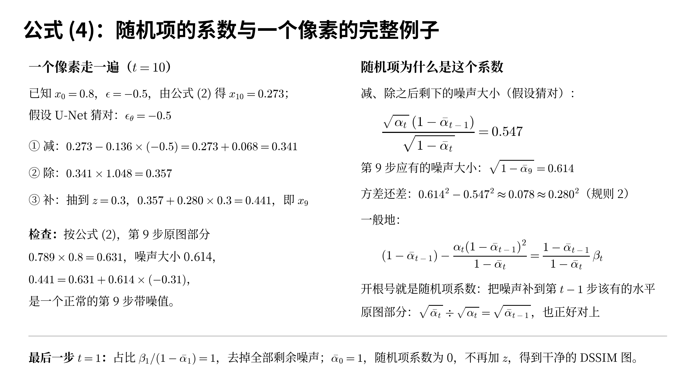

# 公式 (2)(4) 推导讲解稿

说明：这部分只讲公式 (2) 和公式 (4) 的推导，对应 7 张新幻灯片，建议放在原讲稿第 6 页（模型图：公式 (1)～(4)）之后。每节开头是对应幻灯片的缩略图；标“（可选）”的段落时间紧可以跳过。文中的数值都是四舍五入后的结果。

---

## 公式推导 1　公式 (2)：每个变量是什么意思（约 3 分钟）

这一页先把公式 (2) 里的每个符号讲清楚，后面三页再推导它是怎么来的。

$$x_t=\sqrt{\bar{\alpha}_t}\,x_0+\sqrt{1-\bar{\alpha}_t}\,\epsilon,\qquad \epsilon\sim\mathcal{N}(0,\mathbf{I})$$

公式 (2) 读作：xt 等于根号 ᾱt 乘 x0，加上根号 1 − ᾱt 乘 ε，其中 ε 服从 N(0, I)。用大白话说：第 t 步的带噪图，等于一定比例的原图加上一定比例的噪声。

### 每个符号的意思

- x0：干净的 DSSIM 图。训练时它就是标准答案 GT：真脸是全黑图，假脸在伪造的地方发亮。注意，这里的 x 不是人脸，而是 DSSIM 图。
- t 和 T：t 是时间步，表示噪声有多重，t 越大噪声越多。T 是总步数，本文 T = 50。
- ε（epsilon）：一张和 x0 一样大的标准噪声图，每个像素随机抽一个数。
- N(0, I)：正态分布，也叫高斯分布。0 表示平均值是 0；I 是单位矩阵，表示每个像素各抽各的、互不影响，而且方差都是 1。抽出来的数大多数在 −2 到 2 之间。
- βt（beta）：第 t 步新加的噪声量，准确地说是新加噪声的方差。它是事先定好的，不需要学习。补充材料写明它从 0.02 线性增加到 0.4。
- αt（alpha）= 1 − βt：第 t 步原图保留的份额。t = 10 时是 0.910。
- ᾱt（alpha bar）= α1 × α2 × ⋯ × αt：从第 1 步累计到第 t 步，原图还剩的份额。每个 α 都小于 1，所以 t 越大，ᾱt 越小：t = 1 时是 0.98，t = 10 时是 0.567，t = 50 时只剩 0.000005。
- √ᾱt 和 √(1 − ᾱt)：原图前面的系数和噪声前面的系数。份额是按方差算的，所以系数要开平方。t = 10 时分别是 0.753 和 0.658。两者的平方加起来总是 1。
- xt：第 t 步的带噪图。

举个例子：某个像素原值 x0 = 0.8，抽到的噪声 ε = −0.5。t = 10 时，x10 = 0.753 × 0.8 + 0.658 × (−0.5) = 0.602 − 0.329 = 0.273。后面的推导和公式 (4) 都会用这个像素。

---

## 公式推导 2　公式 (2) 的推导（一）：方差的三条规则（约 2 分钟）

推导公式 (2) 只需要用到方差的三条规则，这一页先把它们讲清楚。

方差是什么：把每个数减去平均值，平方，再求平均。噪声的平均是 0，所以噪声的方差就是“噪声平方的平均”。方差开根号叫标准差，表示噪声通常有多大。标准噪声 ε 的方差是 1。

### 规则 1：乘一个数 k，方差变成 k² 倍

$$\mathrm{Var}(k\,\epsilon)=k^2\,\mathrm{Var}(\epsilon)$$

比如噪声取 +1 和 −1，平方都是 1，方差是 1。整体乘 0.3 以后变成 +0.3 和 −0.3，平方都是 0.09，方差就是 0.09，正好是 0.3 的平方。原因很简单：每个数乘了 k，平方以后就乘了 k²。

这条规则解释了公式里为什么到处是根号：想让一份噪声的方差是 βt，前面就要乘 √βt。

### 规则 2：互不相关的两份噪声相加，方差直接相加

$$\mathrm{Var}(a+b)=\mathrm{Var}(a)+\mathrm{Var}(b)$$

看右边的表：a、b 各自随机取 +1 或 −1，互不影响，一共 4 种组合，出现的机会一样。a + b 分别是 2、0、0、−2，平方是 4、0、0、4，平均是 2，正好等于 a 的方差 1 加上 b 的方差 1。

原因是 (a + b)² = a² + 2ab + b²。中间的 ab 时正时负，因为 a、b 互不相关，平均下来是 0，只剩下 a² 和 b² 两部分。

要注意，能直接相加的是方差，不是标准差。标准差要先平方变成方差，加完再开根号。

### 规则 3：高斯噪声相加还是高斯噪声

两份高斯噪声相加，结果仍然是高斯噪声，所以可以把它们合并成一份：方差为 v 的高斯噪声，可以写成 √v 乘一份标准噪声 ε。

$$\sqrt{v_1}\,\epsilon_1+\sqrt{v_2}\,\epsilon_2=\sqrt{v_1+v_2}\;\epsilon$$

例如 0.3ε1 + 0.4ε2：两份的方差是 0.09 和 0.16，加起来是 0.25，开根号是 0.5，所以可以合并成 0.5ε。

---

## 公式推导 3　公式 (2) 的推导（二）：单步加噪，连写两步（约 2 分钟）

### ① 起点：DDPM 规定的单步加噪

公式 (2) 不是凭空来的，它来自 DDPM 原论文对“每一步怎么加噪声”的规定：

$$x_t=\sqrt{\alpha_t}\,x_{t-1}+\sqrt{\beta_t}\,\epsilon_t,\qquad \alpha_t+\beta_t=1$$

意思是：把上一步的图 xt−1 乘 √αt，保留一大部分；再加一份第 t 步新抽的噪声 εt，乘 √βt。为了区分，这里把第 t 步新抽的噪声记作 εt，后面合并出来的总噪声记作 ε。

按规则 1，保留部分的方差份额是 αt，新噪声的方差份额是 βt，加起来正好是 1。这样每一步图的“总量”不变，不会越加越大。

（可选）打个比方：一杯果汁，每一步倒掉 βt 这么多，再兑同样多的水。兑进去的水和杯里原有的水混在一起，分不出是哪一步兑的。

### ② 连写两步

第 1 步是 x1 = √α1 · x0 + √β1 · ε1，第 2 步是 x2 = √α2 · x1 + √β2 · ε2。把 x1 代进第 2 步：

$$x_2=\sqrt{\alpha_2}\left(\sqrt{\alpha_1}\,x_0+\sqrt{\beta_1}\,\epsilon_1\right)+\sqrt{\beta_2}\,\epsilon_2=\sqrt{\alpha_1\alpha_2}\,x_0+\left[\sqrt{\alpha_2\beta_1}\,\epsilon_1+\sqrt{\beta_2}\,\epsilon_2\right]$$

把结果分成两部分看。

原图部分：系数是 √(α1α2)，按 ᾱ 的定义就是 √ᾱ2。每走一步，原图就多乘一个 √α。

噪声部分：方括号里有两份互不相关的噪声 ε1 和 ε2。按规则 1，第一份的方差是 α2β1，第二份是 β2；按规则 2，加起来是：

$$\alpha_2\beta_1+\beta_2=\alpha_2(1-\alpha_1)+(1-\alpha_2)=1-\alpha_1\alpha_2=1-\bar{\alpha}_2$$

这里用到了 β = 1 − α，展开以后 α2 和 −α2 正好抵消。再按规则 3，两份噪声合并成一份 √(1 − ᾱ2) · ε，于是：

$$x_2=\sqrt{\bar{\alpha}_2}\,x_0+\sqrt{1-\bar{\alpha}_2}\,\epsilon$$

这已经是公式 (2) 在 t = 2 时的样子。

代入本文的数验证：α1 = 0.98，β1 = 0.02，α2 = 0.9722，β2 = 0.0278。噪声方差是 0.9722 × 0.02 + 0.0278 = 0.0472；而 1 − ᾱ2 = 1 − 0.98 × 0.9722 = 0.0472，两者相等。

---

## 公式推导 4　公式 (2) 的推导（三）：推广到第 t 步（约 2 分钟）

### ③ 一般的第 t 步

两步能合并，三步、四步也一样。假设第 t − 1 步已经满足公式 (2)：

$$x_{t-1}=\sqrt{\bar{\alpha}_{t-1}}\,x_0+\sqrt{1-\bar{\alpha}_{t-1}}\,\epsilon^{\prime}$$

这里 ε′ 是前 t − 1 步合并出来的噪声。再加一步：

$$x_t=\sqrt{\alpha_t}\,x_{t-1}+\sqrt{\beta_t}\,\epsilon_t=\sqrt{\alpha_t\bar{\alpha}_{t-1}}\,x_0+\left[\sqrt{\alpha_t(1-\bar{\alpha}_{t-1})}\,\epsilon^{\prime}+\sqrt{\beta_t}\,\epsilon_t\right]$$

原图系数：√(αt ᾱt−1) = √ᾱt，因为 ᾱt 就是 ᾱt−1 再乘一个 αt。

噪声方差：旧噪声的方差被乘了 αt，再加上新噪声的方差 βt：

$$\alpha_t(1-\bar{\alpha}_{t-1})+\beta_t=\alpha_t-\bar{\alpha}_t+1-\alpha_t=1-\bar{\alpha}_t$$

所以第 t 步也满足公式 (2)。t = 1 时公式 (2) 本来就成立（ᾱ1 = α1，1 − ᾱ1 = β1），之后一步接一步往后推，每一步都成立，这就得到了公式 (2)。

### 一句话总结

方差的总份额始终是 1。原图的份额每一步乘一次 α，到第 t 步剩 ᾱt；剩下的 1 − ᾱt 都是噪声。公式里的系数是份额开平方。用果汁打比方：第 t 步时果汁还剩 ᾱt，水占 1 − ᾱt。

### 数值例子

右边的表还是用那个像素：x0 = 0.8，ε = −0.5。t = 1 时原图系数 0.990、噪声系数 0.141，x1 = 0.721，基本还是原图；t = 10 时 x10 = 0.273；t = 25 时 x25 = −0.314；t = 50 时原图系数只剩 0.002，x50 = −0.498，几乎就是噪声本身。

### 公式 (2) 的用处

训练时，随机选一个 t、抽一份 ε，代入公式 (2) 就能一步算出第 t 步的带噪图，不用真的一步一步加 t 次噪声。加进去的这份 ε，就是公式 (3) 里让 U-Net 去猜的标准答案。另外，t = 50 时原图几乎不剩，所以测试时可以直接从一张随机噪声图出发。

---

## 公式推导 5　公式 (4)：每个变量的意思与整体结构（约 2 分钟）

公式 (4) 是训练好之后真正使用时的去噪规则。从纯噪声 x50 出发，每用一次公式 (4) 就退一步，图干净一点；从 t = 50 一直用到 t = 1，最后得到的 x0 就是估计的 DSSIM 图。

$$x_{t-1}=\frac{1}{\sqrt{\alpha_t}}\left(x_t-\frac{\beta_t}{\sqrt{1-\bar{\alpha}_t}}\,\epsilon_\theta(x_t,t)\right)+\sqrt{\frac{1-\bar{\alpha}_{t-1}}{1-\bar{\alpha}_t}\,\beta_t}\cdot z$$

用大白话说：退一步的图 = 放大回原来的尺度 ×（当前图 − 第 t 步那份噪声）+ 补一点新的随机数。

### 每个符号的意思

- xt：当前手里的带噪图。第一次是纯随机噪声 x50。
- xt−1：去掉一点噪声后的图，作为下一次的输入。
- εθ(xt, t)：U-Net 猜出的噪声。θ（theta）代表 U-Net 的全部参数。它猜的是 xt 里的总噪声，是标准大小的，方差为 1。论文在公式里省略了条件 c，实际上 U-Net 还看了检测器送来的人脸特征。
- αt、βt、ᾱt：和公式 (2) 是同一组数，没有新东西。
- ᾱt−1：累计到第 t − 1 步的份额。t = 1 时会用到 ᾱ0，约定 ᾱ0 = 1，意思是一步都还没加，原图一点没少。
- z：每一步新抽的随机噪声，也服从 N(0, I)，只在 t > 1 时加。注意 z 和 ε 不是一回事：ε 是训练时加进去让 U-Net 猜的噪声，z 是使用时每一步新补的噪声。

### 为什么是“先减、再除”

回顾单步加噪：xt = √αt · xt−1 + 这一步的噪声，是先乘、再加。要倒回去，就得反过来，先减、再除：xt−1 = (xt − 这一步的噪声) ÷ √αt。这就像一个数先乘 2、再加 3 得到 11，倒推回去要先减 3、再除以 2：(11 − 3) ÷ 2 = 4。

麻烦在于，“这一步的噪声”是不知道的：兑进去的水已经和原来的水混在一起，分不出哪份是第 t 步兑的。所以公式 (4) 用 U-Net 来估计，括号里减掉的就是这个估计值。下一页逐项讲。

---

## 公式推导 6　公式 (4)：逐项解释（约 3 分钟）

这一页把公式 (4) 拆成五项，逐个说明它是什么、为什么这样写。表里最后一列是 t = 10 时的数值。

### ① εθ(xt, t)：猜的噪声

U-Net 看着当前的图 xt、时间步 t 和人脸特征，猜出 xt 里的总噪声。它猜的是标准大小的噪声，方差为 1。在像素例子里，真噪声是 −0.5，这里假设 U-Net 猜对了。

### ② βt / √(1 − ᾱt)：减噪系数

这一项决定这一步减掉多少噪声。可以把它拆成两个数相乘：

$$\frac{\beta_t}{\sqrt{1-\bar{\alpha}_t}}=\frac{\beta_t}{1-\bar{\alpha}_t}\times\sqrt{1-\bar{\alpha}_t}$$

第一个数 βt / (1 − ᾱt)：按公式 (2)，xt 里噪声的方差总量是 1 − ᾱt，其中第 t 步新加的是 βt，所以这个比值是“第 t 步那份噪声占总噪声的比例”。t = 10 时是 0.0898 ÷ 0.433 ≈ 0.207，约 21%。

第二个数 √(1 − ᾱt)：U-Net 猜的是标准大小的噪声，按公式 (2)，它在 xt 里要乘这个数，这是噪声在 xt 里的实际大小。t = 10 时是 0.658。

两者相乘：0.207 × 0.658 = 0.136。所以这一项的意思是：从猜出的总噪声里，只去掉第 t 步那一份。

为什么不一次把噪声全去掉？因为我们只往回退一步，只需要去掉一步的噪声。如果一次全去掉，就等于让 U-Net 一步猜出最终答案，结果容易糊，这正是论文想避免的“直接回归”。

（可选）这是帮助理解的说法。严格的推导是用贝叶斯公式，把 xt 和 x0 两条线索合并，得到的结果完全一样。

### ③ 1/√αt：放大系数

加噪时，这一步把图乘了 √αt，比 1 小一点；去噪时要除回去，把尺度恢复到第 t − 1 步。t = 10 时是 1.048。可以验证：原图部分的系数 √ᾱt 除以 √αt，正好等于 √ᾱt−1，也就是第 t − 1 步该有的原图系数。

### ④ 随机项系数

√[(1 − ᾱt−1) / (1 − ᾱt) · βt]，t = 10 时是 0.280。它的作用是把噪声量补到第 t − 1 步应有的水平。为什么正好是这个数，下一页用例子算给大家看。

### ⑤ z：新的随机数

每一步新抽一份标准噪声，乘上随机项系数后加进去。最后一步 t = 1 时不加。

---

## 公式推导 7　公式 (4)：随机项的系数与一个像素的完整例子（约 3 分钟）

### 一个像素走一遍（t = 10）

还是那个像素：x0 = 0.8，ε = −0.5，按公式 (2)，x10 = 0.273。假设 U-Net 猜对了，εθ = −0.5。

① 减：减噪系数乘猜的噪声是 0.136 × (−0.5) = −0.068，于是 0.273 − (−0.068) = 0.341。

② 除：乘放大系数，0.341 × 1.048 = 0.357。

③ 补：假设这一步抽到 z = 0.3，随机项是 0.280 × 0.3 = 0.084，于是 x9 = 0.357 + 0.084 = 0.441。

检查一下：按公式 (2)，第 9 步的原图部分是 √ᾱ9 × x0 = 0.789 × 0.8 = 0.631，噪声大小是 √(1 − ᾱ9) = 0.614。0.441 = 0.631 + 0.614 × (−0.31)，相当于抽到了一份 −0.31 的噪声，是一个正常的第 9 步带噪值。也就是说，公式 (4) 确实把图从第 10 步的状态退到了第 9 步的状态。

### 随机项为什么是这个系数

先只看“减、再除”这两步。假设 U-Net 猜得完全对，做完这两步，图里剩下的噪声大小是：

$$\frac{\sqrt{\alpha_t}\,(1-\bar{\alpha}_{t-1})}{\sqrt{1-\bar{\alpha}_t}}$$

t = 10 时是 0.547。而按公式 (2)，第 9 步的图应该有的噪声大小是 √(1 − ᾱ9) = 0.614。噪声偏少了。

缺多少？用规则 2 算方差：0.614² − 0.547² ≈ 0.377 − 0.299 = 0.078，开根号约 0.280，正好是随机项的系数。写成一般的式子：

$$(1-\bar{\alpha}_{t-1})-\frac{\alpha_t(1-\bar{\alpha}_{t-1})^2}{1-\bar{\alpha}_t}=\frac{1-\bar{\alpha}_{t-1}}{1-\bar{\alpha}_t}\,\beta_t$$

（可选）化简过程：先提出 (1 − ᾱt−1)，剩下 1 − αt(1 − ᾱt−1) / (1 − ᾱt)。通分后分子是 1 − ᾱt − αt + αt ᾱt−1，而 αt ᾱt−1 = ᾱt，所以分子等于 1 − αt = βt。

所以随机项的作用是：把噪声量正好补到第 t − 1 步该有的水平。验证一下：√(0.547² + 0.280²) ≈ 0.614。

为什么一定要补齐？因为 U-Net 在第 t − 1 步学的就是“噪声有这么多”的图，噪声量不对，下一步它就猜不准。另外，每一步保留一点随机性，也能避免结果变成“平均答案”而发糊。

### 最后一步 t = 1

t = 1 时，x1 里的噪声全是第 1 步加的，占比 β1 / (1 − ᾱ1) = 0.02 ÷ 0.02 = 1，所以会把剩下的噪声全部去掉。同时 ᾱ0 = 1，随机项系数是 0，不再加 z。这样最后得到的 x0 就是一张干净的 DSSIM 图。

---

## 附：时间紧时的精简说法

### 公式 (2)

DDPM 规定每一步保留上一步的 √αt，再加 √βt 的新噪声，并且 αt + βt = 1。连续展开时，原图的系数每一步乘一次 √α，累积成 √ᾱt；各步加入的噪声互相独立，方差可以直接相加，总和正好是 1 − ᾱt，所以可以合并成一份噪声 √(1 − ᾱt) · ε，得到公式 (2)。

### 公式 (4)

每一步去噪都是把一步加噪倒过来做：先从 xt 里减去 U-Net 估计出的第 t 步那一份噪声，系数是 βt / √(1 − ᾱt)；再除以 √αt 恢复尺度；最后加上随机项，把噪声量补到第 t − 1 步应有的水平。最后一步不加随机项，得到干净的 DSSIM 图。
